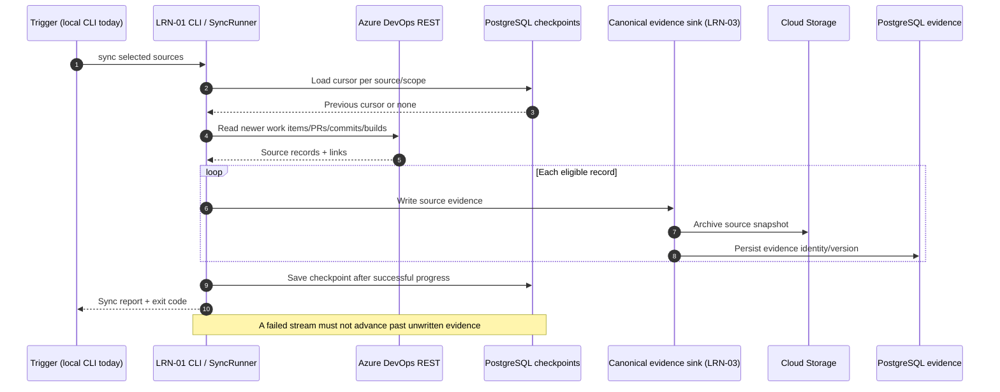
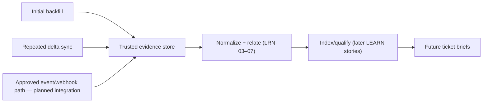

# LRN-01 — Architecture and data flow

## Source-to-evidence sequence

This depicts the *canonical mode* conceptually. There are additional graph/link projection steps, per-item handling, revision processing and exception cases in implementation.

## Responsibilities

| Concern | Component | Description |
|---|---|---|
| Entry point | `src/VisionIQ.Ingestor.Cli/Program.cs` | Parses CLI, chooses JSONL/canonical mode, creates dependencies and reports results |
| ADO integration | `src/VisionIQ.Ingestor/Ado/` | REST clients/readers for work items, Git and build sources |
| Orchestration | `src/VisionIQ.Ingestor/Sync/SyncRunner.cs` | Loops approved scopes; processes streams and checkpoints |
| Local export | `src/VisionIQ.Ingestor/Sync/JsonLinesSink.cs` | Writes envelopes `{"key", "fetchedAt", "record"}` |
| Checkpoints | `src/VisionIQ.Ingestor/Checkpoints/` | File or PostgreSQL cursor storage |
| Canonical destination | `src/VisionIQ.Ingestor.Cli/CanonicalEvidenceSink.cs` and evidence services | Evidence archival/persistence (LRN-03 boundary) |

## What LEARN always-on means

**The LEARN capability can be continuously current without an always-running ingestor process.** Scheduled jobs or event triggers run ingestion repeatedly, with checkpoints and downstream processing.

## Critical boundaries

- **LRN-01** connects and reads source history, handles failures and checkpoints.
- **LRN-03** archives/normalizes canonical evidence; its storage guarantees need separate acceptance.
- **LRN-07** projects evidence-backed relationships, not raw-source connectivity.
- **LRN-02** handles Confluence; its permission controls and testing are separate.
- Pipeline inventory only identifies definitions; successful ingestion of actual **build runs** requires a separate test (completed 2026-11-02).
