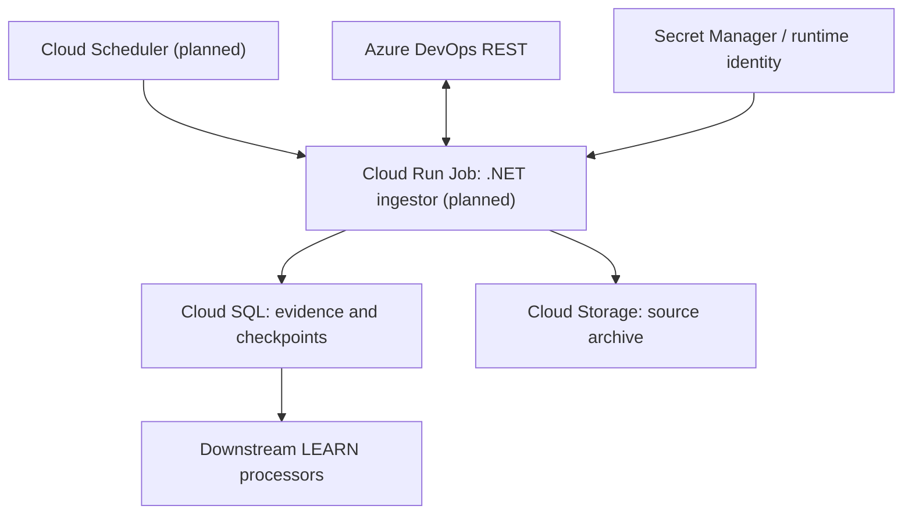

# LRN-01 — Google Cloud execution model

## What is already demonstrated

- Local Windows PowerShell successfully launched the **.NET ingestor CLI** against real approved ADO sources.
- The ingestor has successfully written canonical evidence to a test PostgreSQL instance and GCS archive.
- VisionIQ API and intelligence services have been manually deployed to Cloud Run in the project's wider foundation work.

## What is **not** yet deployed for LRN-01

A production-equivalent **scheduled Cloud Run Job for the ingestor**, Cloud Scheduler trigger, automatic retry/synchronization schedule, cloud runtime service identity and end-to-end health checks have **not** been evidenced. Do not confuse an API Cloud Run service with an ingestion job.

## Proposed deployment

A local `dotnet run --project ... -- sync` launches compiled .NET code. In a container, the **same application** may be started with `dotnet VisionIQ.Ingestor.Cli.dll sync --source ...` using a suitable Docker image, arguments and configuration; **PowerShell itself is not required**. That is an illustrative container invocation, not a verified deployment command.

## Pre-deployment checklist

1. Determine approved ADO scopes, source credentials, API throttling and data residency.
2. Build a dedicated ingestor image; verify that it includes the correct .NET runtime and application assemblies.
3. Configure GCP runtime service account with minimum Secret Manager, Cloud SQL, GCS and execution permissions.
4. Validate private networking, Cloud SQL connectivity, data policies, and source API connectivity from within GCP.
5. Test one controlled delta sync in isolation, checking checkpoints, reports and audit data.
6. Schedule and monitor jobs, alert on `NotSynced`, and prevent unintended overlapping runs.
7. Exercise pause/retry/reconciliation before enabling production-style schedules.

**Avoid claiming continuous cloud learning until the scheduler/event triggers and downstream processing are deployed and tested.**
