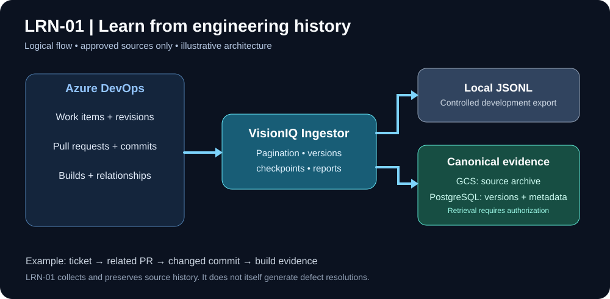
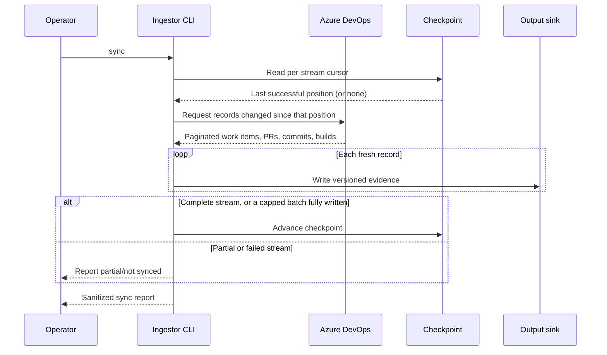
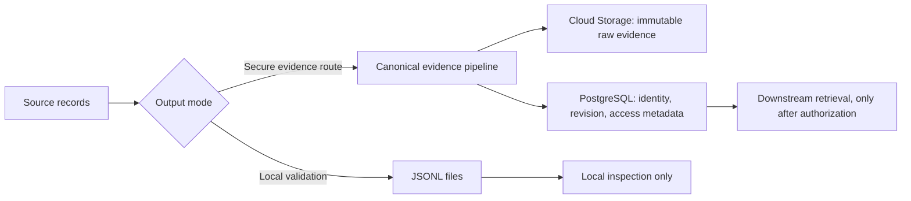

# LRN-01 — Illustrated walkthrough: history connectors

This is an explanation-first companion to the [technical guide](README.md), not a replacement. Diagrams show the logical architecture, not a claim that all Cloud Run components have been deployed.

## 1. Why does VisionIQ need history connectors?

**Example (illustrative, not a real corporate ticket):** A kiosk payment fails after a retry. Azure DevOps has the original incident, a developer's investigation, a PR with a fix, its commit and a subsequent build. If VisionIQ reads only the ticket title, it cannot explain what changed or cite the engineering evidence. LRN-01 captures those source records as separate, traceable items.

## 2. What happens on a run?

The checkpoint is read **first**, because it decides what to ask Azure DevOps for. It advances only after records are written: for a complete stream, or for a batch that hit the 20,000-item query cap (progress is kept so the next run continues). A failed stream never advances past unwritten records.

**Inventory** answers “Can I reach these sources and how much history is present?” **Sync** answers “Which history can I collect and persist?” A successful source connection alone does not demonstrate full historical coverage or downstream reasoning quality.

## 3. What is a checkpoint?

Imagine a bookshelf with about 4,400 ticket folders. A checkpoint is a *bookmark for a particular source stream*, not evidence that all folders were read. A later run resumes from an acknowledged position. If a stream fails partway, do not advance its bookmark as though the run succeeded.

## 4. Why do JSONL and canonical modes differ?

Local JSONL is useful for checking shapes and counts; it is not an ACL-aware retrieval service. Canonical storage organizes evidence and permissions, but storing an item does not itself mean it is safe to show to every engineer.

## 5. Real test observations versus illustration

The previously documented LRN-01 runs found **4,438 work items, 9 repositories and 22 pipelines** (inventory recorded in the [test report](../../LRN-01-Test-Report.md); counts change as ADO grows) in the approved inventory; test evidence further includes **86 builds and 149 links**, **402/402 regression tests**, and **8/8 changed-file fidelity**. Consult the dated [test report](../../LRN-01-Test-Report.md) for scope and caveats. None of these figures alone proves the AI can produce a correct fix recommendation.

## 6. Where to go next

For implementation files, consult [implementation](implementation.md); for repeatable local testing, [local testing](local-testing.md); for ongoing operation, [operations](operations.md); and for outstanding approval, [acceptance](acceptance.md). Do not merge the draft PR or publish corporate evidence as part of this walkthrough.
