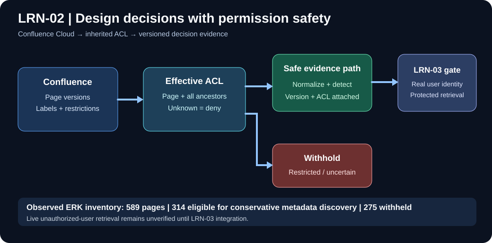

# LRN-02 — Include design decisions from Confluence

**Documentation baseline:** 2 November 2026  
**Implementation status:** Implemented and locally exercised  
**Documentation status:** Complete as-of baseline; updates tracked here  
**User-story acceptance:** OPEN: the per-user read check is implemented and unit-tested; a live allow/deny demonstration needs a surface that returns Confluence evidence (see [Acceptance](04-Acceptance-and-LRN03-Handoff.md))

**Start with [the illustrated step-by-step walkthrough](05-Illustrated-Walkthrough.md)** — realistic synthetic examples, Mermaid flows, inherited ACL examples and explanations of each ERK count.

## Document index
1. [Architecture and implementation](01-Architecture-and-Implementation.md) — behavior, code locations, ACL model and storage boundaries.
2. [Setup and operations](02-Setup-and-Operations.md) — configuration, safe commands, diagnostics and operational limits.
3. [Test report and evidence](03-Test-Report-and-Evidence.md) — reported 37/37 tests, 589-page inventory, controlled sync, discovery outputs and unverified scenarios.
4. [Acceptance and LRN-03 handoff](04-Acceptance-and-LRN03-Handoff.md) — original acceptance criteria, security contract, risks and final signoff checklist.
5. [Illustrated walkthrough](05-Illustrated-Walkthrough.md) — diagram-based explanation, practical examples and test-result interpretation.

## Verified user-run evidence
- Confluence Cloud approved ERK space: **589 pages**, **527 complete** ACLs, **62 incomplete**.
- ACL classification: **314 complete/unrestricted**, **213 complete/restricted**, **61 incomplete/unrestricted**, **1 incomplete/restricted**.
- Local JSONL sample since 2026-11-01: **2 versioned page snapshots**, **589 ACL records**, **3 page snapshots withheld**, **0 unsafe exported page matches**, partial sync exit **2**.
- Automated filtered suite: **37 passed, 0 failed, 0 skipped**.
- Safe discovery: **0 title candidates**, **0 label candidates**, **0 label lookup failures** among 314 eligible pages. This is not a template/body search.
- **Implemented, not yet demonstrated live:** per-user read check through Confluence's own permission check (identity map + Entra ID; Data Center pages stay hidden). Denial from search and AI context, and revocation at retrieval time, still need a delivery surface to demonstrate.

## Decision
We can finish and freeze the LRN-02 **documentation baseline** now. We must **not** mark the story itself 100% accepted until a positive and a negative live authorization test pass through a VisionIQ endpoint that returns Confluence evidence (the per-user check exists; the delivery surface does not yet). Neither production Cloud Run behavior nor complete 589-page historical content ingestion has been verified here.

## Safety
Keep credential values and Confluence contents out of source control. Read-only discovery is not proof of access for any particular engineer, and `--since` does not bypass full-space ACL evaluation. See the operations guide before new live runs.

## Commands: what to run and what not to repeat

See the [LRN-01 and LRN-02 command register](../LEARN-01-02-Command-Register.md) for routine commands, recorded test runs, expected outcomes, write-side safety checks, and operations that should **not** be repeated as everyday steps.

## Storage dependency status (3 November 2026)

LRN-03 original evidence-storage acceptance is now **COMPLETE**; this does not change LRN-02's **OPEN** live requester-authorization acceptance. See [LRN-03 final acceptance](../LRN-03-versioned-evidence/04-Test-Evidence-and-Acceptance.md).
