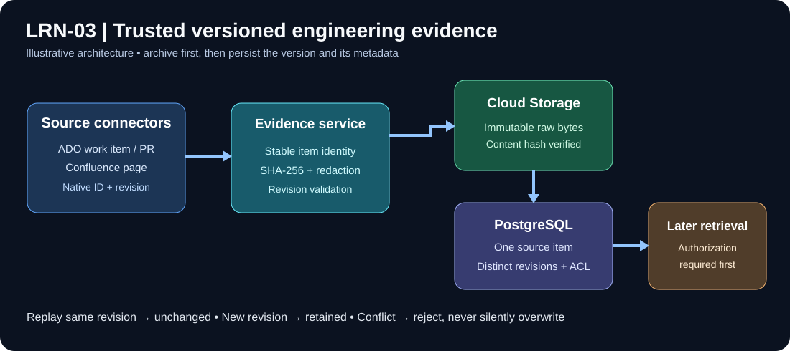
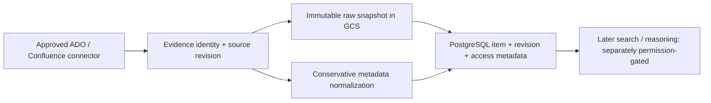

# LRN-03 — Store history as versioned evidence

> **Story:** [LRN-03 on Trello](https://trello.com/c/aqRFYZ9G/9-learn-lrn-03-store-history-as-versioned-evidence)
> **Status:** **COMPLETE (original storage scope)**, verified 2 November 2026 with real PostgreSQL and
> Cloud Storage tests. LRN-03 was implemented earlier alongside LRN-01–07; this folder documents the
> review that audited it against the Trello card and verified it.
> **Scope:** S05-01 to S05-06 and S05-11: versioned evidence persistence in PostgreSQL, immutable raw
> archive in Cloud Storage, conservative metadata normalization.



## At a glance

| Original acceptance criterion | Result | Evidence |
| --- | --- | --- |
| Each record keeps its source ID, revision, timestamps and access list | **PASS** | Isolated PostgreSQL test 1/1: every persisted identity, revision, timestamp, URL, retrieval identity, ACL and archive column asserted |
| A raw copy is kept in Cloud Storage; sensitive fields are redacted before indexing | **PASS** | Real isolated GCS test 1/1 (exact bytes, SHA-256, unchanged object generation on replay); metadata redaction tests 8/8 |
| Re-importing the same item updates it instead of creating a duplicate | **PASS** | Isolated PostgreSQL test 1/1: Created → NewRevision → Unchanged → Unchanged → Conflict; one item, two revisions, correct latest |

**Completion evidence (Trello):** the same item imported twice leaves **one logical record with two
source revisions**. Verified by the isolated PostgreSQL test above. Full results, commands and history:
[test evidence and acceptance](04-Test-Evidence-and-Acceptance.md).

## Documentation

| Document | Read it to |
| --- | --- |
| [01 — Code audit and Trello task mapping](01-Code-Audit.md) | See where each Trello task is implemented and what was verified |
| [02 — Architecture and implementation](02-Architecture-and-Implementation.md) | Understand identity, revisions, archive, redaction and access boundaries |
| [03 — Setup, commands and troubleshooting](03-Setup-Commands-and-Troubleshooting.md) | Prepare an isolated database and run the checks safely (Windows PowerShell) |
| [04 — Test evidence and acceptance](04-Test-Evidence-and-Acceptance.md) | See every observed result, the acceptance decision and the dated test history |
| [05 — Cloud Storage archive verification](05-GCS-Archive-Verification.md) | Understand and re-run the real GCS integrity and immutability test |
| [06 — Index and retrieval audit](06-Index-Retrieval-Deployment-Audit.md) | See what is outside LRN-03: search indexing and per-user retrieval |
| [Architecture image](images/lrn03-evidence-flow.svg) | Source → archive → versioned database at a glance |

## The problem LRN-03 solves

An Azure DevOps ticket changes many times: its description is edited, a PR is attached, it is
resolved. If VisionIQ kept only the latest text it would lose **what was known when**. If every sync
inserted a new item, results would fill with duplicates. If private text went straight into searchable
metadata, it could leak secrets.

**Example (fictional):** a ticket is imported at revision 3. Importing revision 3 again changes
nothing. Importing revision 4 keeps revision 3, adds revision 4 and moves the "latest" pointer. Both
raw revisions stay traceable to their source, and no private free text enters searchable metadata.

## How it works



1. **Identity:** provider, source instance, project, optional repository, item kind and external ID
   are combined into a stable item key, so different sources never collide.
2. **Version:** the source's own revision ID and update time describe the change; the observation time
   records when VisionIQ saw it. Both are kept.
3. **Redaction:** `EvidenceNormalizer` copies only an allowlist of short structured fields (for example
   state and work-item type) into searchable metadata. Descriptions, comments, commit messages and raw
   environment text never enter it.
4. **Archive first:** the raw bytes are hashed (SHA-256) and written to Cloud Storage **before** the
   database revision is recorded. If archiving fails, nothing is written to the database.
5. **Upsert:** replaying the same revision is a no-op; a new revision gets its own row; the same
   revision ID with **different** content is a **Conflict**, never a silent overwrite.
6. **Access:** each revision stores its access list. Storing it does not by itself decide what a
   particular engineer may see; that is decided at read time (see [Boundaries](#what-lrn-03-does-not-cover)).

## Code map

| Source location | Responsibility |
| --- | --- |
| `src/VisionIQ.Api/Features/Evidence/EvidenceModels.cs` | Stable identity, access metadata, version envelope, metadata normalizer |
| `src/VisionIQ.Api/Features/Evidence/EvidenceIngestionService.cs` | Validation, SHA-256, redaction, archive-before-database order |
| `src/VisionIQ.Api/Features/Evidence/RawEvidenceArchive.cs` | Cloud Storage archive (`CloudStorageEvidenceArchive`): content-addressed, create-only uploads |
| `src/VisionIQ.Api/Features/Evidence/PostgresEvidenceStore.cs` | Item and revision persistence, idempotent upsert, conflict detection |
| `src/VisionIQ.Ingestor.Cli/CanonicalEvidenceSink.cs` | Maps connector records to canonical evidence envelopes |
| `db/migrations/versions/20261030_0002_versioned_evidence.py` | `evidence.source_items` / `evidence.source_revisions` schema and constraints |
| `tests/VisionIQ.Ingestor.Tests/Lrn03EvidenceBoundaryTests.cs` | Archive order, archive failure, identity separation, redaction (8 tests) |
| `tests/VisionIQ.Ingestor.Tests/Lrn03PostgresIntegrationTests.cs` | Opt-in real PostgreSQL acceptance test (`LRN03_TEST_DB=1`) |
| `tests/VisionIQ.Ingestor.Tests/Lrn03GcsArchiveIntegrationTests.cs` | Opt-in real Cloud Storage test (`LRN03_TEST_GCS=1`) |

## Trello implementation tasks

| Task | Status | How it was verified |
| --- | --- | --- |
| S05-01 Canonical evidence schema | **Verified** | Migration applied to an isolated database (14 evidence tables); persisted columns asserted by the PostgreSQL test |
| S05-02 Source identity strategy | **Verified** | Identity separation in the boundary tests; persisted identity columns in the PostgreSQL test |
| S05-03 Raw immutable snapshot archive | **Verified** | Real isolated GCS test: exact bytes, SHA-256, no overwrite on replay |
| S05-04 Work-item revision normalization | **Verified for work items** | Work-item current/revision mappings in the sink; persisted revision test |
| S05-05 PR, commit, review normalization | **Partly** | PR and commit mappings present and redaction-tested; review comments are not ingested on `feature/learn` (they are added to PR records by LRN-12 on `feature/learn-08-14`) |
| S05-06 CI, deployment, incident normalization | **Partly** | CI builds mapped; deployment and incident records have no source mapping yet (no connector produces them; see LRN-14) |
| S05-11 Deduplication / upsert | **Verified** | PostgreSQL test: replay unchanged, new revision added, conflicting content rejected |

## How to re-run the checks

The three commands are in [03 — Setup, commands and troubleshooting](03-Setup-Commands-and-Troubleshooting.md):
the boundary tests run anywhere; the PostgreSQL and GCS tests are **opt-in** and must only target an
isolated database and an approved isolated bucket.

```powershell
dotnet test .\tests\VisionIQ.Ingestor.Tests\VisionIQ.Ingestor.Tests.csproj `
  --configuration Release `
  --filter "FullyQualifiedName~Lrn03EvidenceBoundaryTests"
if ($LASTEXITCODE -ne 0) { throw "LRN-03 boundary tests failed" }
```

**Expected:** 8 passed, 0 failed, 0 skipped, exit 0.

## What LRN-03 does not cover

- **Search indexing and retrieval** are outside this storage story. On `feature/learn` no index writer
  exists ([06](06-Index-Retrieval-Deployment-Audit.md)). The LEARN search index (LRN-08 and later) is
  being built on `feature/learn-08-14`; it must pass the sentinel test described in 06 once merged.
- **Per-engineer access to Confluence pages** is decided at read time by LRN-02's live Confluence
  permission check; see [LRN-02 acceptance](../LRN-02-CONFLUENCE/04-Acceptance-and-LRN03-Handoff.md).
- **Bucket-wide retention and IAM** are infrastructure responsibilities; the code prevents overwrites
  of individual objects.
- **Rows stored before the redaction hardening** keep their old metadata until they are re-imported.

## Follow-ups (non-blocking)

1. **The opt-in tests handle a missing opt-in inconsistently.** The PostgreSQL test returns early and
   is reported as **passed**, so a log alone does not prove it ran. The GCS test **throws**, so an
   ordinary `dotnet test` without `LRN03_TEST_GCS=1` reports a **failure**; this has made the CI .NET
   job fail on `feature/learn` since the test was added (commit `9c05d76`). Both should report an
   explicit **skip** when not opted in.
2. Build warnings (63–65 depending on the run) are analyzer advisories, not failures; see the
   [LRN-01 warning review](../LRN-01-HISTORY-CONNECTORS/acceptance.md).
3. Historic rows: re-import or backfill if older metadata must match the hardened allowlist.

**Related:** [LRN-01 visual guide](../LRN-01-HISTORY-CONNECTORS/visual-guide.md) ·
[LRN-02 acceptance](../LRN-02-CONFLUENCE/04-Acceptance-and-LRN03-Handoff.md) ·
[Canonical evidence contract](CONTRACTS.md)
