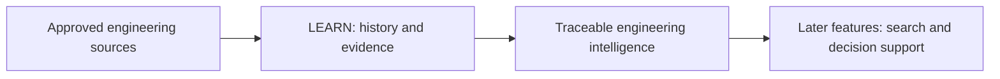
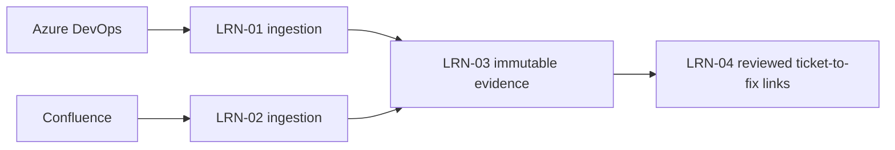
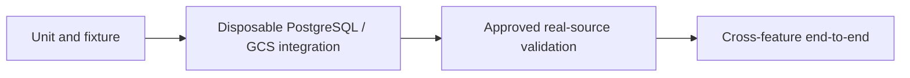
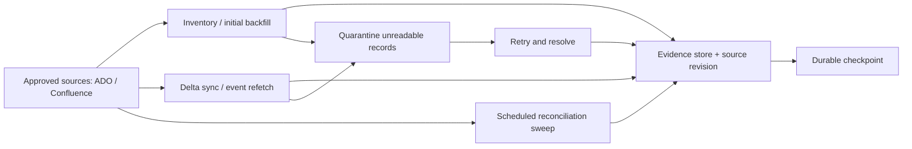

# VisionIQ Developer Team Guide

**Version 1.7 - 05 November 2026**  
**Platform:** Windows 11, PowerShell, .NET 10, Python 3.12, PostgreSQL, Google Cloud  
**Scope:** Local setup; LRN-01 to LRN-05; controlled testing; FND-06 cloud-validation handoff.

> **Source preservation:** Chapters 1-16 below are transcribed from the original 26-page version 1.6 PDF. The new LRN-05 chapter is authoritative for the current test evidence. Where older chapter wording conflicts with current repository code or LRN-05, use the tested code and the new chapter. The original diagrams remain in the companion PDF; textual equivalents are included in this Markdown edition.

**Read before use:** This guide is an instructional artifact. It contains no credentials. Never commit `.env`, database passwords, PATs, source evidence exports or internal operational logs. Live company project names, URLs and work-item identifiers are deliberately omitted from the published acceptance example.

## Quick navigation

- [First-day setup and previous chapters](#original-guide---chapters-1-16)
- [LRN-05: complete source history and currentness](#17-lrn-05---backfill-incremental-sync-reconciliation-and-recovery)
- [LRN-05 tested evidence](#176-executed-local-acceptance-evidence)
- [FND-06 handoff and outstanding gates](#179-cloud-validation-handoff-fnd-06)

## Original guide - chapters 1-16

<!-- Original PDF page 1 -->
VisionIQ Developer Bible Install · Run · Connect · Test Windows 11 · PowerShell · .NET 10 · Python 3.12 · PostgreSQL · Google Cloud

Start VisionIQ on your laptop A. First day: get the code and configure it

Open PowerShell. Make sure Git, Docker Desktop, .NET 10 and Python 3.12 are installed. Use your team’s approved repository URL. Your .env stays on your machine.

```powershell
# Use your approved working folder.
New-Item -ItemType Directory -Force "$HOME\source" | Out-Null
Set-Location "$HOME\source"
$teamRepo = Read-Host 'Paste the approved VisionIQ Git clone URL'
if ([string]::IsNullOrWhiteSpace($teamRepo)) { throw 'A repository URL is required' }
git clone $teamRepo visioniq
if ($LASTEXITCODE -ne 0) { throw 'Could not clone the approved repository' }
Set-Location .\visioniq
if (-not (Test-Path .\VisionIQ.sln)) { throw 'Open the repository root containing VisionIQ.sln' }
```

```powershell
py -3.12 -m venv .venv
if ($LASTEXITCODE -ne 0) { throw 'Python 3.12 is required' }
# This works even when script activation is restricted.
.\.venv\Scripts\python.exe --version
.\.venv\Scripts\python.exe -m pip install -r .\requirements.txt
if ($LASTEXITCODE -ne 0) { throw 'Python dependencies could not be installed' }
```

if (-not (Test-Path .env)) { Copy-Item .env.example .env } notepad .env

In .env, select DB_TARGET=local and set three different local passwords: DB_LOCAL_PASSWORD, DB_API_PASSWORD, DB_INTELLIGENCE_PASSWORD. Keep .env private. Use the existing usernames and local database settings from the template unless your team specifies otherwise.

```powershell
B. Start the application
docker compose config --quiet
if ($LASTEXITCODE -ne 0) { throw 'Review the .env configuration' }
docker compose up --build -d
if ($LASTEXITCODE -ne 0) { throw 'Startup failed; see logs below' }
docker compose ps -a
docker compose logs --tail=80 db-migrate
```

```powershell
Expected: PostgreSQL healthy, migration job Exited (0), API and Intelligence running. Check both services:
Invoke-RestMethod http://localhost:5100/health -TimeoutSec 10
Invoke-RestMethod http://localhost:8000/health -TimeoutSec 10
```

Both should return successful health responses. If not, go to Troubleshooting.

```powershell
C. Run the basic tests
dotnet test .\VisionIQ.sln --configuration Release
if ($LASTEXITCODE -ne 0) { throw '.NET test failure' }
.\.venv\Scripts\python.exe -m pytest -q
if ($LASTEXITCODE -ne 0) { throw 'Python test failure' }
```

<!-- Original PDF page 2 -->
If tests are skipped, check whether they need a separate PostgreSQL or GCS test environment before recording them as complete. The LRN-01–04 chapters give feature-specific commands.

```powershell
Already installed? Your normal workday
$repoDir = Read-Host 'Enter the local VisionIQ repository folder path'
Set-Location $repoDir
git status --short
docker compose up -d
docker compose ps -a
```

For local troubleshooting, docker compose logs --tail=100 api intelligence db-migrate. To stop while retaining the database, use docker compose stop.

Choose your next task I want to…                                                         Go to

Install missing tools, verify versions and configure the           Local setup · Database setup database

Connect to Azure DevOps and test history ingestion                 LRN-01

Connect to Confluence and verify page restrictions                 LRN-02

Test PostgreSQL and GCS evidence storage                           LRN-03

Verify ticket-to-PR/commit associations                            LRN-04

Test all four features in one controlled workflow                  Connected test

Investigate a setup or testing error                               Troubleshooting

Inspect the cloud environment                                      Google Cloud

LEARN features in this edition Feature                                     What the developer should see             Main evidence

LRN-01                                      ADO work items, PRs, commits and          Sync report, checkpoints, source IDs build history are read from approved scopes

```text
 LRN-02                                      Confluence decision candidates are        Page/ACL report, positive and
                                             discovered; unclear/restricted access     negative access tests
                                             fails closed
```

```text
 LRN-03                                      Original evidence is archived and         PostgreSQL revisions, GCS SHA-256,
                                             versioned without duplicate records       replay results
```

```text
 LRN-04                                      Historical defects can be linked to       Ticket-fix records, source evidence,
                                             source-declared PRs and commits           revert/dispute tests
                                             without inventing fixes
```

The Cloud Infrastructure & Operations Guide covers cloud provisioning, deployment and rollback. This Bible covers developer setup, day-to-day work, source connections and tests through LRN-04.

<!-- Original PDF page 3 -->
Contents Chapter                                        Topic

1                                              Understand the VisionIQ architecture

2                                              Install prerequisites

3                                              Detailed local setup

4                                              Database accounts and isolated test database

5                                              Start and verify services

6                                              Daily developer commands

7                                              How to interpret test results

8                                              LRN-01 — Azure DevOps

9                                              LRN-02 — Confluence

10                                             LRN-03 — Versioned evidence

11                                             LRN-04 — Ticket-to-fix links

12                                             LRN-01–04 connected test

13                                             Record test results

14                                             Backup and restore

15                                             Troubleshooting

16                                             Cloud development and checks

## 1. System overview: what the developer is building

VisionIQ is an engineering intelligence platform. Its LEARN phase builds a traceable history from approved engineering evidence. It reads work items, PRs, commits, builds and Confluence decisions, preserves raw versions, and records evidence-backed associations. Later features add code intelligence, relationships, search and AI-assisted recommendations; they are outside the acceptance scope of this edition.

**Figure 1. VisionIQ platform workflow (conceptual)**




The platform diagram shows intended phases, not a claim that all phases are implemented or accepted.

<!-- Original PDF page 4 -->
**Figure 2. LEARN LRN-01 to LRN-04 evidence pipeline**




Source ingestion and archival are separate from verifying a fix and authorizing retrieval.

Runtime components Component                                   Responsibility                         Local reference

```text
 postgres                                    PostgreSQL 16, pgvector and            Docker Compose; typically host port
                                             application schemas                    5432
```

db-migrate                                  Schema migrations and role setup       One-time job; expected to exit 0

api                                         .NET API and evidence persistence      http://localhost:5100

intelligence                                Python API / analysis service          http://localhost:8000

VisionIQ.Ingestor.Cli                       ADO/Confluence ingestion and           .NET CLI; separate from API health local/canonical sync

Architecture boundary: ingestion does not mean AI training. A stored link is not automatically a verified fix. A recorded ACL snapshot does not grant a viewer permission; current source authorization may still be required.

## 2. Prerequisites and version verification

Use only organization-approved tools and repository access. Do not use another developer’s local credentials, Docker project names or personal GitHub URL as the team default.

```powershell
Run from PowerShell, any folder:
git --version
docker version
docker compose version
py --list
dotnet --list-sdks
code --version # optional editor
```

```powershell
Open Docker Desktop and confirm its engine is available. At the repository root, inspect the code-pinned versions
rather than trusting an older PDF:
if (Test-Path .\global.json) { Get-Content .\global.json }
if (Test-Path .\.python-version) { Get-Content .\.python-version }
Get-ChildItem -Recurse -Filter *.csproj | Select-String 'TargetFramework'
```

The reviewed November code is reported as targeting .NET 10 and Python 3.12. Confirm this on the exact checkout; older onboarding notes reference .NET 8 or Python 3.11.

## 3. Detailed local setup

Run from an approved local workspace. Replace placeholders before executing:

<!-- Original PDF page 5 -->
```powershell
New-Item -ItemType Directory -Force "$HOME\source" | Out-Null
Set-Location "$HOME\source"
$teamRepo = Read-Host 'Paste the approved VisionIQ Git clone URL'
if ([string]::IsNullOrWhiteSpace($teamRepo)) { throw 'A repository URL is required' }
git clone $teamRepo visioniq
if ($LASTEXITCODE -ne 0) { throw 'Could not clone the approved repository' }
Set-Location .\visioniq
```

```powershell
git branch --show-current
git rev-parse HEAD
git status --short
Test-Path .\docker-compose.yml
Test-Path .\.env.example
# Create and configure .env before validating Compose interpolation.
```

Expect docker-compose.yml and .env.example to exist. After configuring .env, docker compose config -- services should identify postgres, db-migrate, api, and intelligence on a branch with the documented local stack. Do not switch, pull or clean branches automatically if someone else is working in the same checkout.

First-time credentials if (-not (Test-Path .\.env)) { Copy-Item .\.env.example .\.env } notepad .\.env

The .env file is configuration data, not PowerShell commands. Configure strong, distinct local passwords and save them in the company-approved password manager. Do not copy .env into documentation, Git or chat.

Setting                                                             Purpose

```powershell
DB_TARGET=local                                                     Selects the local development database target
```

```powershell
DB_LOCAL_NAME / DB_LOCAL_USER                                       Local DB and administrator for provisioning
```

```powershell
DB_LOCAL_PASSWORD                                                   Local administrator password
```

```powershell
DB_API_USER / DB_API_PASSWORD                                       .NET service database identity
```

```powershell
DB_INTELLIGENCE_USER /                                              Python service identity
```

```powershell
DB_INTELLIGENCE_PASSWORD
```

```powershell
DB_LOCAL_PORT                                                       Host-side local PostgreSQL port (normally 5432)
```

APP_LOG_LEVEL=INFO                                                  Supported Python logging level

Important: editing .env does not reset the passwords already stored in a PostgreSQL Docker volume. A Docker socket connection can succeed even when a TCP password-authenticated connection fails.

Prepare the Python development environment

```powershell
The local migration commands and Python tests later in this book use .\.venv\Scripts\python.exe from the
repository root. Create it once before proceeding to Chapter 4.
py -3.12 --version
if ($LASTEXITCODE -ne 0) { throw 'Install the approved Python 3.12 launcher/interpreter' }
if (-not (Test-Path .\.venv\Scripts\python.exe)) {
py -3.12 -m venv .venv
if ($LASTEXITCODE -ne 0) { throw 'Virtual environment creation failed' }
}
```

<!-- Original PDF page 6 -->
```powershell
.\.venv\Scripts\python.exe -m pip install -r .\requirements.txt
if ($LASTEXITCODE -ne 0) { throw 'Python dependency installation failed' }
.\.venv\Scripts\python.exe -m pip check
if ($LASTEXITCODE -ne 0) { throw 'Python dependencies inconsistent' }
```

Activate and deactivate Python

In a new PowerShell terminal at the repository root, activate the existing environment: & .\.venv\Scripts\Activate.ps1 python --version python -m pip check

You should see (.venv) before your prompt. To leave the environment, run deactivate. If Windows prevents script activation, do not change machine-wide security settings; the same Python and test commands work directly through .\.venv\Scripts\python.exe. For example:

```powershell
.\.venv\Scripts\python.exe -m pytest -q
```

The .venv directory is local machine state; do not commit it. If the active branch has a different dependency lockfile, use that branch’s reviewed installation instructions.

Local setup — primary procedure and optional helper scripts

The documented route does not depend on the optional helper scripts. Configure .env as above, check the resolved target, then follow Chapter 5 to start the services. The setup and database helper scripts may not exist in every branch. The commands below work without them. Only run a helper after confirming it is checked into your approved branch. # After configuring .env, check the Compose service names and interpolation. docker compose config --quiet if ($LASTEXITCODE -ne 0) { throw 'Compose configuration failed. Check .env.' } docker compose config --services

Expected services on the documented stack: postgres, db-migrate, api, intelligence. If any differ, review the checked-out Compose file before running start commands.

```powershell
If available, the supplied setup.ps1 expects its location to be scripts/setup.ps1: it computes the repository root
from its own parent folder. Do not run the standalone uploaded file from an arbitrary location.
Test-Path .\scripts\check-env.ps1
Test-Path .\scripts\setup.ps1
if (Test-Path .\scripts\check-env.ps1) {
.\scripts\check-env.ps1
}
if (Test-Path .\scripts\setup.ps1) {
.\scripts\setup.ps1       # non-destructive configuration check
# Only when the inspected script and target are approved:
# .\scripts\setup.ps1 -Start
} else {
Write-Host 'Optional setup script absent; use Chapter 5 Docker Compose commands.'
}
```

The optional uploaded script refuses cloud targets, active DB_* shell overrides, missing/duplicate local role passwords and unexpected local name/port. It does not delete volumes. It may create .env if missing. Review the code on the active branch before using it.

<!-- Original PDF page 7 -->
If one of the scripts is absent, skip that command. The documented Compose route in Chapter 5 is sufficient. Never copy an unknown script over a newer reviewed version.

## 4. Database identities, target selection and isolation

These values refer to roles in a database, not separate databases.

Identity                                 Typical purpose                         Never use it for

DB_LOCAL_USER                            Provisioning/migration                  Routine application queries administrator on a fresh local volume

```powershell
DB_API_USER                              Restricted .NET runtime account         Administrative migrations
```

```powershell
DB_INTELLIGENCE_USER                     Restricted Python runtime account       Unapproved evidence writes
```

```powershell
DB_CLOUD_USER                            Approved Cloud SQL identity             Casual local testing
```

```text
 DB_USER                                  Generic connection selected by          Assuming all services use the same
                                          local/cloud helper scripts              role
```

Choose one target before running a command:

Your task               Database                Host port                 Credentials               Use it for

```text
 Start VisionIQ          visioniq (Compose)      5432                      Values in private         Normal local
 normally                                                                  .env                      application
                                                                                                     development
```

Run DB-writing LRN      visioniq_lrn03_te       55433                     Fresh test-only           Isolated, disposable integration tests                                                         values in a dedicated     tests st (separate PowerShell terminal container)

The ports are different on purpose. Do not create a second test container when one already exists; inspect it first. Never use Cloud SQL or the everyday development database for the tests in this chapter.

Never run database-writing tests until the actual effective target is proven to be disposable. Different tools read different settings (DB_NAME versus DB_LOCAL_NAME); a correctly named .env.test file alone is not isolation, because db.manage does not automatically load it.

```powershell
Inspect process overrides without printing passwords:
Get-ChildItem Env: | Where-Object {
$_.Name -match '^(DB_|APP_LOG_LEVEL|COMPOSE_)' -and
$_.Name -notmatch '(PASSWORD|TOKEN|SECRET|KEY)'
} | Select-Object Name, Value
```

Fresh isolated PostgreSQL test database

This path works without setup-test-db.ps1 or .env.test.example. It is for a developer-owned disposable database only and does not touch the normal visioniq database. The image has PostgreSQL 16 and pgvector; Docker must be running, port 55433 available, and the private passwords must be new local test-only values. These test passwords can be visible to administrators of the local Docker engine; never use company/shared credentials.

1. Check whether an isolated container already exists. Do not replace it if it does.

<!-- Original PDF page 8 -->
$container = 'visioniq-lrn03-test-postgres' $existing = @(docker ps -a --format '{{.Names}}' | Where-Object { $_ -eq $container }) if ($existing.Count -gt 0) { Write-Host 'Existing isolated test container found. Inspect it; do not recreate or delete it.' } else { Write-Host 'No isolated test container found. Use the create steps below if approved.' } Get-NetTCPConnection -LocalPort 55433 -ErrorAction SilentlyContinue

2. New container only, after checking the port and container name are free. Enter distinct passwords at the hidden prompts. The password environment variable is passed to Docker by name, not typed as a command argument. # STOP if the exact container already exists or port 55433 is occupied. if (@(docker ps -a --format '{{.Names}}' | Where-Object { $_ -eq 'visioniq-lrn03-test-postgres' }).Count) { throw 'Test container exists: inspect it rather than creating another.' } if (Get-NetTCPConnection -LocalPort 55433 -ErrorAction SilentlyContinue) { throw 'Port 55433 already in use.' } if (@(docker volume ls --format '{{.Name}}' | Where-Object { $_ -eq 'visioniq_lrn03_sandbox_pgdata' }).Count) { throw 'An existing test DB volume was found. Inspect it; do not initialize over it.' }

```powershell
Enter three different test-only passwords:
$adminSecure = Read-Host 'New LOCAL TEST database administrator password' -AsSecureString
$apiSecure = Read-Host 'New LOCAL TEST API role password' -AsSecureString
$intelSecure = Read-Host 'New LOCAL TEST Intelligence role password' -AsSecureString
$adminPlain = [System.Net.NetworkCredential]::new('', $adminSecure).Password
$apiPlain = [System.Net.NetworkCredential]::new('', $apiSecure).Password
$intelPlain = [System.Net.NetworkCredential]::new('', $intelSecure).Password
if (!$adminPlain -or !$apiPlain -or !$intelPlain -or
(@(@($adminPlain,$apiPlain,$intelPlain) | Select-Object -Unique).Count -ne 3)) {
throw 'All three distinct test passwords are required.'
}
```

Create the dedicated PostgreSQL container: $env:POSTGRES_PASSWORD = $adminPlain try { docker run -d --name visioniq-lrn03-test-postgres ` -p 127.0.0.1:55433:5432 ` -e POSTGRES_USER=visioniq_test ` -e POSTGRES_DB=visioniq_lrn03_test ` -e POSTGRES_PASSWORD ` -v visioniq_lrn03_sandbox_pgdata:/var/lib/postgresql/data ` pgvector/pgvector:pg16 if ($LASTEXITCODE -ne 0) { throw 'Could not create test PostgreSQL container' } } finally { Remove-Item Env:POSTGRES_PASSWORD -ErrorAction SilentlyContinue }

3. Set the isolated connection in this dedicated PowerShell window only (not the shared .env), then verify the exact target before migrating. These variables override .env for this terminal. Do not use the terminal for ordinary development or Cloud SQL work. $env:DB_TARGET='local' $env:DB_HOST='127.0.0.1' $env:DB_PORT='55433'

<!-- Original PDF page 9 -->
```powershell
$env:DB_NAME='visioniq_lrn03_test'
$env:DB_LOCAL_NAME='visioniq_lrn03_test'
$env:DB_LOCAL_USER='visioniq_test'
$env:DB_LOCAL_PASSWORD=$adminPlain
$env:DB_API_USER='visioniq_lrn03_api'
$env:DB_API_PASSWORD=$apiPlain
$env:DB_INTELLIGENCE_USER='visioniq_lrn03_intelligence'
$env:DB_INTELLIGENCE_PASSWORD=$intelPlain
```

```powershell
$expected = @{DB_TARGET='local';DB_HOST='127.0.0.1';DB_PORT='55433';
DB_NAME='visioniq_lrn03_test';DB_LOCAL_NAME='visioniq_lrn03_test';
DB_LOCAL_USER='visioniq_test';DB_API_USER='visioniq_lrn03_api';
DB_INTELLIGENCE_USER='visioniq_lrn03_intelligence'}
foreach ($name in $expected.Keys) {
if ([Environment]::GetEnvironmentVariable($name) -ne $expected[$name]) {
throw "Incorrect test target value for $name"
}
}
if (($env:DB_HOST -ne '127.0.0.1') -or $env:DB_PORT -ne '55433') {
throw 'Refusing unsafe test database target'
}
docker exec visioniq-lrn03-test-postgres pg_isready -U visioniq_test -d visioniq_lrn03_test
if ($LASTEXITCODE -ne 0) { throw 'Test database not ready; inspect docker logs' }
```

4. Apply migrations and configure roles only on this verified disposable database. db.manage accepts all (migrate + roles + verify), while bootstrap is not a CLI option. All these operations write to the chosen database, including verify probe tables.

```powershell
.\.venv\Scripts\python.exe -m db.manage all
if ($LASTEXITCODE -ne 0) { throw 'Isolated DB migrate/roles/verify failed' }
docker exec visioniq-lrn03-test-postgres psql -U visioniq_test `
-d visioniq_lrn03_test -c 'SELECT version_num FROM alembic_version;'
```

5. Validate the restricted runtime role with a password-authenticated TCP login. The database administrator’s local socket login alone is not sufficient. $dbProbe = @' import os import psycopg

with psycopg.connect( host="127.0.0.1", port=55433, dbname="visioniq_lrn03_test", user=os.environ["DB_API_USER"], password=os.environ["DB_API_PASSWORD"], ) as connection: print(connection.execute("SELECT current_user, current_database()").fetchone()) '@ .\.venv\Scripts\python.exe -c $dbProbe if ($LASTEXITCODE -ne 0) { throw 'Isolated API role cannot authenticate' }

The exact output must identify visioniq_lrn03_api and visioniq_lrn03_test. Never paste passwords or full .env into a report. The isolated named Docker volume is intentionally retained; never use docker volume prune or docker compose down -v for cleanup. After testing, close the dedicated terminal to clear its session overrides.

<!-- Original PDF page 10 -->
```powershell
Isolated test-database helper
Test-Path .\scripts\setup-test-db.ps1
# Only if the script AND a private .env.test already exist:
if ((Test-Path .\scripts\setup-test-db.ps1) -and (Test-Path .\.env.test)) {
.\scripts\setup-test-db.ps1 -VerifyMigration
}
```

Optional; skip if absent. Use only if the helper and private .env.test already exist; a fresh-clone path requiring neither is provided above. .env.test is not auto-loaded by db.manage; do not rely on it to select a database. The supplied script does not create a test DB or apply migrations. It checks expected test-target values and reads the Alembic revision from a specifically named disposable container. Older copies of this helper hard-code migration 20261103_0018. Do not use that check as the final migration gate on a newer branch. Compare the database revision against the checked-out repository’s Alembic head, using the commands below, instead. If they differ, stop and inspect the migration state; never downgrade a database solely to satisfy a helper script. # Database revision (read-only, on the isolated test container): docker exec visioniq-lrn03-test-postgres psql -U visioniq_test ` -d visioniq_lrn03_test -tAc 'SELECT version_num FROM alembic_version;' # Repository migration head (read-only; uses the project's Python environment): .\.venv\Scripts\python.exe -m alembic -c db/alembic.ini heads

Both should indicate the intended current migration head for the frozen commit.

The database CLI documented for the existing project supports migrate, roles, verify and all. bootstrap is not a valid CLI action. These are database-changing commands (even verify may create/drop test tables); do not run them against Cloud SQL or an ordinary development database to make tests pass.

## 5. Start and verify local services

**Figure 3. Daily developer workflow**

After confirming .env, the effective target and Compose configuration:

```powershell
docker compose config --quiet
if ($LASTEXITCODE -ne 0) { throw 'Invalid Compose configuration' }
docker compose up --build -d
if ($LASTEXITCODE -ne 0) { throw 'Compose startup failed' }
docker compose ps -a
docker compose logs --tail=100 db-migrate
```

Expected states: PostgreSQL healthy; db-migrate exited 0; API and Intelligence healthy. A container reporting Started is not necessarily ready. Check health: Invoke-RestMethod http://localhost:5100/health -TimeoutSec 10 Invoke-RestMethod http://localhost:8000/health -TimeoutSec 10

Only test /ready where the current implementation actually provides it. A 404 for /ready is not a passed database readiness check. Verify database connectivity separately, with each application’s configured runtime role.

For the documented default local database only:

<!-- Original PDF page 11 -->
```powershell
docker compose exec postgres psql -U visioniq -d visioniq -c 'SELECT 1;'
docker compose exec postgres psql -U visioniq -d visioniq -c '\dx'
docker compose exec postgres psql -U visioniq -d visioniq -c '\dn'
```

Adapt the role/database from the approved local configuration before using these commands. A successful container- socket psql session does not prove the runtime password and grants are correct.

## 6. Daily development quick path

Goal                                                               Command

```text
 Confirm branch and commit                                          git branch --show-current; git rev-parse --
                                                                    short HEAD
 Detect uncommitted work                                            git status --short
 Start without rebuilding                                           docker compose up -d
 See container and job states                                       docker compose ps -a
 Recent logs                                                        docker compose logs --tail=100 api
                                                                    intelligence db-migrate
 Rebuild local code                                                 docker compose up --build -d
 Stop, preserve data                                                docker compose stop
 Build .NET                                                         dotnet build .\VisionIQ.sln --configuration
                                                                    Release
 Run general .NET tests                                             dotnet test .\VisionIQ.sln --configuration
                                                                    Release
 Activate virtual environment                                       & .\.venv\Scripts\Activate.ps1
 Deactivate virtual environment                                     deactivate
 Check Python interpreter                                           python -c "import sys; print(sys.executable)"
 Run Python tests                                                   .\.venv\Scripts\python.exe -m pytest -q
 Python lint                                                        .\.venv\Scripts\python.exe -m ruff check .
```

Never use docker compose down -v, docker volume prune, git reset --hard or git clean -fd as routine cleanup. A plain docker compose down normally preserves named volumes, but stop is the least disruptive daily choice. Avoid commands that switch branches while another developer/AI is editing the same working tree.

## 7. How to interpret test results

**Figure 4. Testing evidence levels**




<!-- Original PDF page 12 -->
Each level requires independent execution evidence; skipped tests never count as passing.

Evidence level                                What it proves                          What it does not prove

A — Unit/fixture                              Logic works for controlled inputs       Real provider permissions or DB writes

B — Disposable integration                    Actual PostgreSQL/GCS interactions      Full corporate source history and cleanup

```text
 C — Approved real-source                      Source API behavior and selected        Cloud deployment or every edge
 validation                                    fidelity                                case
```

D — Cross-feature end-to-end                  Connected chain across                  Unexecuted later LEARN features implemented components

For every test, record: date, branch, full commit SHA, dirty/clean status, intended target, exact command, pass/fail/skip counts, actual output, cleanup and open limitations. Skipped opt-in tests are neither failures nor passes; they remain unexecuted acceptance checks. A total green solution suite is not sufficient evidence of real- source or cloud acceptance.

```powershell
Baseline .NET/Python validation
git rev-parse HEAD
git status --short
```

```powershell
dotnet build .\VisionIQ.sln --configuration Release
if ($LASTEXITCODE -ne 0) { throw '.NET build failed' }
dotnet test .\VisionIQ.sln --configuration Release --no-build
if ($LASTEXITCODE -ne 0) { throw '.NET tests failed' }
```

```powershell
if (-not (Test-Path .\.venv\Scripts\python.exe)) {
py -3.12 -m venv .venv
if ($LASTEXITCODE -ne 0) { throw 'Could not create Python virtual environment' }
}
.\.venv\Scripts\python.exe -m pip install -r requirements.txt
if ($LASTEXITCODE -ne 0) { throw 'Python dependency installation failed' }
.\.venv\Scripts\python.exe -m pip check
if ($LASTEXITCODE -ne 0) { throw 'Python dependencies are inconsistent' }
.\.venv\Scripts\python.exe -m pytest -q
if ($LASTEXITCODE -ne 0) { throw 'Python tests failed' }
.\.venv\Scripts\python.exe -m ruff check .
if ($LASTEXITCODE -ne 0) { throw 'Python lint failed' }
```

Use repository-approved dependency procedures for the current branch if requirements.txt, tool names or pinned versions differ. Confirm discovered test counts, not only process exit code. Earlier review runs recorded passing unit tests with database-gated tests skipped. Record the actual test and skip counts from your own reviewed commit; do not infer an integration pass from a green unit suite.

## 8. LRN-01 — Read engineering history from Azure DevOps

What this feature does

A defect may have been addressed in a prior ticket and PR. LRN-01 reads approved work items, their comments/revisions, PRs, commits, changed-file metadata and CI builds. It reports per-stream state and uses checkpoints to resume a later run. It does not decide whether a PR really fixed a defect; that is LRN-04’s job.

<!-- Original PDF page 13 -->
Inputs: approved ADO organization/projects, read-only PAT, optional repository/pipeline allowlists, sync options. Output: JSONL/checkpoints for local runs, or canonical LRN-03 evidence for approved integration runs. Key code: SyncRunner, AdoWorkItemSource, AdoRepositorySource, AdoCommitSource, AdoBuildSource, VisionIQ.Ingestor.Cli.

Configure the Azure DevOps connection

Obtain approved read-only credentials from the organization. The identity must be permitted to see the chosen Azure DevOps organization and project; Work Items (Read) covers tickets/revisions, Code (Read) covers repositories/PRs/commits, and Build (Read) is needed for build history. Permission to write tickets, approve PRs or merge code is not needed. If an endpoint needs further read permissions for PR policies/threads, resolve that through the administrator rather than broadening the token arbitrarily.

Add the following keys to your private .env; these are examples of names, not credential values:

```powershell
ADO_ORG_URL=https://dev.azure.com/<approved-organization>
ADO_PROJECTS=<approved-project-name>
ADO_REPOS=<approved-repository-name>
ADO_PIPELINE_IDS=<approved-pipeline-definition-ids>
ADO_READ_PAT=<private-read-only-token>
```

ADO_PROJECTS accepts the approved project selection from the current configuration contract; inspect the active repo’s parsing rules before using multiple names. Empty ADO_REPOS may read all repositories in approved projects; an empty ADO_PIPELINE_IDS may read every pipeline in those projects. Start with narrowly approved values. Never put the PAT on a command line, in a log, in the Bible or in a screenshot. .env and shell variables can disagree: validate the application’s resolved nonsecret configuration before a write.

Connection verification, without evidence ingestion (PowerShell at repository root): git rev-parse --short HEAD dotnet run --configuration Release --project .\src\VisionIQ.Ingestor.Cli -- inventory Write-Host "ADO inventory exit code: $LASTEXITCODE"

Look for the approved project, work-item counts, repository inventory and pipeline-definition counts; a zero exit establishes reported source reachability, not that every record was archived. Inventory can also inspect configured Confluence sources, so if those are unavailable inspect the source-specific result instead of assuming ADO failed. ADO denied/expired tokens must yield a failed/NOT_SYNCED source, not an empty-success result.

ADO controlled local import — only after source and output approvals

For a bounded exercise, use local JSONL/file checkpoints in an isolated, Git-ignored directory. Verify that the effective application settings really select this destination before execution. If changing PowerShell variables in an existing session, make sure they do not unintentionally redirect database or cloud settings. $env:INGESTION_OUTPUT_MODE = 'jsonl' $env:CHECKPOINT_STORE = 'file' $env:INGESTION_OUTPUT_DIR = 'artifacts/ingestion/team-lrn01-verification' # Source READ; isolated local file writes and checkpoint advancement: dotnet run --configuration Release --project .\src\VisionIQ.Ingestor.Cli -- ` sync --source work-items Write-Host "Work-item sync exit code: $LASTEXITCODE"

The CLI produces a report.json under its run directory. Check stream, received/stored/not-stored counts, quarantine, checkpoint scope and overall exit code. Replaying the same unchanged scope should not duplicate canonical content; JSONL output may still create a fresh run folder. Do not infer global completeness merely because a delta is empty. Do not run --full or remove checkpoints without a separately approved test plan.

<!-- Original PDF page 14 -->
For a controlled repo and build test, after confirming the repository and pipeline allowlists, use --source commits,pull-requests or --source builds; never assume ADO_REPOS limits build ingestion.

ADO test verdict Check                                         Evidence to retain                            Pass condition

```text
 Inventory                                     Approved project/repo counts and              Source reachable with intended
                                               sanitized exit                                scope
```

Ingest                                        report.json, run ID, stream status            No unexplained skipped/failed items

Checkpoint replay                             Baseline/new counts and checkpoint            No duplicate canonical revisions

Failure simulation                            Unit/controlled test report                   Unavailable source is NOT_SYNCED, not zero

```text
 Source fidelity                               Approved read-only sampled ADO                Correct identities, revisions and
                                               comparison                                    changed files
```

```powershell
Safe local code tests (no live ADO)
dotnet test .\tests\VisionIQ.Ingestor.Tests\VisionIQ.Ingestor.Tests.csproj `
--configuration Release `
--filter 'FullyQualifiedName~SyncRunnerTests|FullyQualifiedName~AdoSourceTests|FullyQualifiedName~CheckpointKeyTests|
FullyQualifiedName~StreamIsolationTests' `
--verbosity minimal
```

Expected: at least one selected test, zero failures. Verify checkpoint resume, independent scopes, unavailable source NOT_SYNCED, no false empty-success, and no duplicate replay. The independent review reported newly identified cursor risks R1-01/R1-02; fixes were reported later but need re-execution on the final frozen commit.

Live-source inventory (approved READ) dotnet run --configuration Release --project .\src\VisionIQ.Ingestor.Cli -- inventory

This queries the configured source and may create a local inventory report. It does not import source evidence. Only use approved credentials and sources.

```powershell
Ingestion (approved WRITE to selected destination)
# Do not run until source scope, output mode, checkpoints, database and bucket are verified.
dotnet run --configuration Release --project .\src\VisionIQ.Ingestor.Cli -- sync --source work-items
```

Before PR/commit or build sync, set the approved ADO_REPOS and ADO_PIPELINE_IDS filters. ADO_REPOS does not limit build ingestion. A --since argument does not necessarily override existing checkpoints. Never clear checkpoints to manufacture a successful result.

Recorded evidence (dated, do not expect these counts on every run) •       Approved real ADO source inventory and historical syncs exercised work items, PRs, commits and builds.

•       Five sampled historical revisions matched 20/20 compared ADO fields; one sampled Git commit matched 8/8 changed files.

•       Five selected canonical GCS objects matched their PostgreSQL SHA-256 references (5/5).

•       Failure and unauthorized-source tests established that inaccessible sources should not be represented as empty.

<!-- Original PDF page 15 -->
Remaining boundary: sample fidelity is not exhaustive coverage of every item or the entire LEARN graph; cursor fixes and full-source replay require validation on the final reviewed code.

## 9. LRN-02 — Ingest Confluence design decisions safely

What this feature does

An engineering decision may explain why a past fix was made. LRN-02 reads approved Confluence pages and versions, extracts decision candidates and preserves permission metadata. Ingestion and visibility are different: an engineer should see a page only when current Confluence permissions authorize that engineer.

Inputs: approved site/space, read-only account/token, identity mapping for authorized per-user checks. Outputs: versioned page/decision evidence, ACL metadata and eligibility diagnostics. Key code: ConfluenceCloudSource, ConfluenceText, DesignDecisionDetector, ConfluencePageAccessVerifier.

Configure the Confluence connection

The organization must approve a Confluence site, space keys and read-only access. Use a Cloud account/token or an approved Data Center PAT according to the deployment. Configure in private .env:

```powershell
CONFLUENCE_BASE_URL=https://<approved-tenant>.atlassian.net/wiki
CONFLUENCE_SPACE_KEYS=<approved-space-key>
CONFLUENCE_USER_EMAIL=<approved-credential-account>
CONFLUENCE_API_TOKEN=<private-token>
CONFLUENCE_DEPLOYMENT=cloud
```

For per-user Confluence Cloud retrieval authorization, the application additionally uses CONFLUENCE_IDENTITY_MAP_FILE (private mapping of an authenticated engineer to their Atlassian account ID). If it is missing, access must fail closed; a successful ingestion alone does not permit a developer to see private pages. Never publish identity mappings, private page bodies or ACL details.

```powershell
Connection and discovery (read-only provider calls):
# The inventory command checks the configured ADO/Confluence sources.
dotnet run --configuration Release --project .\src\VisionIQ.Ingestor.Cli -- inventory
# This discovery can make many approved Confluence API requests.
dotnet run --configuration Release --project .\src\VisionIQ.Ingestor.Cli -- discover-confluence-decisions
Write-Host "Confluence discovery exit code: $LASTEXITCODE"
```

Inspect reported pages, complete/restricted/incomplete ACL and label-lookup-failures. A space listing with incomplete restrictions is not proof that those pages can be shown. Reading the results: 0 candidates means no matches in the title/label discovery scope, not that no design decisions exist in page bodies. PARTIAL means some pages were withheld or couldn’t be classified; do not report it as an empty successful import.

```powershell
Controlled local sync, only when approved and necessary:
$env:INGESTION_OUTPUT_MODE = 'jsonl'
$env:CHECKPOINT_STORE = 'file'
$env:INGESTION_OUTPUT_DIR = 'artifacts/ingestion/team-confluence-verification'
dotnet run --configuration Release --project .\src\VisionIQ.Ingestor.Cli -- `
sync --source confluence --since 2026-11-01
Write-Host "Confluence sync exit code: $LASTEXITCODE"
```

<!-- Original PDF page 16 -->
The date is an example and may not constrain ACL discovery; an existing checkpoint can take precedence over -- since. Confirm the approved scope and whether another run is actually needed. This imports to local files/checkpoints; the raw output remains private even if a page is unrestricted inside the company.

Permission acceptance: positive and negative

Use an approved test page P in an approved sandbox space: user A must be allowed and user B denied. Fetch through the actual authenticated VisionIQ read surface using user A, user B, then revoke A’s Confluence permission and retest. Expected: A sees P only while entitled; B always sees nothing; revocation is enforced without waiting for stale cached ACLs. If the requisite authenticated endpoint/identity mapping is not available, mark this acceptance BLOCKED, not PASS. Never substitute raw Confluence API access with the ingestor’s service credentials for user authorization.

```powershell
Automated tests
dotnet test .\tests\VisionIQ.Ingestor.Tests\VisionIQ.Ingestor.Tests.csproj `
--configuration Release `
--filter 'FullyQualifiedName~Confluence|FullyQualifiedName~ContentRevisionTests' `
--verbosity minimal
```

Recorded historical selected run: 37 passed. This is fixture/security logic, not a live user A/B permission demonstration. Ensure the actual filter discovers tests on the current branch.

Controlled source discovery (approved READ) dotnet run --configuration Release --project .\src\VisionIQ.Ingestor.Cli -- discover-confluence-decisions

The historical approved-space inventory reported 589 pages: 527 complete ACL evaluations and 62 incomplete. A title/label-only discovery found no candidates among 314 complete/unrestricted pages; this does not establish that no decision exists in page bodies. This command can make many provider requests; do not rerun casually.

Acceptance checklist •      ☐ Page identity, version, ancestor restrictions and source URLs verified.

•      ☐ Incomplete/restricted pages are withheld, not presented as empty or public.

•      ☐ Authorized user can read an approved test page through an actual VisionIQ retrieval surface.

•      ☐ Unauthorized user and revocation tests deny the same content.

The last two checks remained OPEN in the source report. Do not mark LRN-02’s permission acceptance passed merely because the automated suite is green.

## 10. LRN-03 — Preserve canonical, versioned evidence

Run LRN-03 against isolated PostgreSQL and GCS

Use a separate database, not the normal local development database and not Cloud SQL. The previously tested local target is visioniq-lrn03-test-postgres, mapped to 127.0.0.1:55433, database visioniq_lrn03_test. This is a reusable example only if that test container exists on the team’s machine and its roles and migrations have been intentionally configured. The uploaded setup-test-db.ps1 validates an existing .env.test; it does not create the database or load that file into the applications.

```powershell
Read-only preflight:
docker ps -a --filter 'name=visioniq-lrn03-test-postgres'
docker port visioniq-lrn03-test-postgres 5432/tcp
# EXPECT loopback binding to 127.0.0.1:55433, not ordinary port 5432.
```

<!-- Original PDF page 17 -->
```powershell
docker exec visioniq-lrn03-test-postgres `
psql -U visioniq_test -d visioniq_lrn03_test -X -v ON_ERROR_STOP=1 `
-c 'SELECT current_database(), current_user; SELECT version_num FROM public.alembic_version;'
```

If the container does not exist, use the team’s approved isolated test-database provisioning procedure. Do not silently point these examples at the ordinary local DB. After a schema change, back up the disposable database and migrate it using the exact current branch’s python -m db.manage migrate and python -m db.manage roles commands, with the effective target verified first. Even verify may create/drop test tables. Do not treat the hard-coded expected 0018 in the old helper as the current migration head after later review changes.

```powershell
Run local non-DB boundary tests:
dotnet test .\tests\VisionIQ.Ingestor.Tests\VisionIQ.Ingestor.Tests.csproj `
--configuration Release `
--filter 'FullyQualifiedName~Lrn03EvidenceBoundaryTests'
```

```powershell
Run opt-in PostgreSQL only after the test DB is migrated, test API role works and the resolved settings are confirmed.
Never paste passwords into the handbook:
$env:DB_HOST = '127.0.0.1'
$env:DB_PORT = '55433'
$env:DB_NAME = 'visioniq_lrn03_test'
$env:DB_LOCAL_NAME = 'visioniq_lrn03_test'
$env:DB_API_USER = 'visioniq_lrn03_api'
# DB_API_PASSWORD is supplied securely from the private test credential store.
$env:LRN03_TEST_DB = '1'
dotnet test .\tests\VisionIQ.Ingestor.Tests\VisionIQ.Ingestor.Tests.csproj `
--configuration Release `
--filter 'FullyQualifiedName~Lrn03PostgresIntegrationTests'
Write-Host "LRN-03 PostgreSQL exit code: $LASTEXITCODE"
```

```powershell
The opt-in GCS test creates a synthetic object in the configured bucket and checks immutable/idempotent archive
behavior; run only against a separately approved private test bucket, with the approved ADC identity:
# After confirming GCS_EVIDENCE_BUCKET names the designated disposable test bucket:
$env:LRN03_TEST_GCS = '1'
dotnet test .\tests\VisionIQ.Ingestor.Tests\VisionIQ.Ingestor.Tests.csproj `
--configuration Release `
--filter 'FullyQualifiedName~Lrn03GcsArchiveIntegrationTests'
Write-Host "LRN-03 GCS exit code: $LASTEXITCODE"
```

Clear the opt-in variables afterwards. Record tests executed / passed / skipped, and verify a test that was marked skipped actually ran when enabled. A real bucket must be explicitly approved; never borrow a shared archive bucket to make the result green.

Read-only baseline counts from the specifically named disposable database: docker exec visioniq-lrn03-test-postgres ` psql -U visioniq_test -d visioniq_lrn03_test -X -v ON_ERROR_STOP=1 ` -c 'SELECT (SELECT count(*) FROM evidence.source_items) AS items, (SELECT count(*) FROM evidence.source_revisions) AS revisions, (SELECT count(*) FROM evidence.ticket_fix_links) AS ticket_links;'

Interpretation: two revisions and one item are correct when one synthetic source item changes once; identical replay should not grow the revision count; same revision ID with different bytes must be a conflict, not a silent overwrite. Exact GCS bytes must hash to the recorded content_sha256. A test that archives successfully but fails to write PostgreSQL is not an end-to-end PASS.

<!-- Original PDF page 18 -->
What this feature does

A defect changes between revisions. LRN-03 preserves what arrived and when, archives the original raw JSON in private GCS, and records stable identity, source revision, source/observed timestamps, approved metadata and access lists in PostgreSQL. An unchanged replay is not a new logical item. The same revision ID with conflicting bytes is an error, not an overwrite.

Canonical path: CanonicalEvidenceSink → EvidenceIngestionService → create-only GCS archive → PostgresEvidenceStore. If archiving fails, the corresponding DB revision must not be committed.

```powershell
Local boundary tests
dotnet test .\tests\VisionIQ.Ingestor.Tests\VisionIQ.Ingestor.Tests.csproj `
--configuration Release `
--filter 'FullyQualifiedName~Lrn03EvidenceBoundaryTests' `
--verbosity minimal
```

Previously documented result: 8 passed. Verify the test count again on the reviewed checkout.

Disposable PostgreSQL and approved GCS tests

The existing project has opt-in Lrn03PostgresIntegrationTests and Lrn03GcsArchiveIntegrationTests. They must be run separately, only after inspecting their exact guard environment variables and proving their destinations are disposable/approved. The historic flags were LRN03_TEST_DB=1 and LRN03_TEST_GCS=1. Revisions or flags may change during ongoing review. # READ code and verify test DB and bucket before enabling opt-in tests. Get-Content .\tests\VisionIQ.Ingestor.Tests\Lrn03PostgresIntegrationTests.cs | Select-Object -First 45 Get-Content .\tests\VisionIQ.Ingestor.Tests\Lrn03GcsArchiveIntegrationTests.cs | Select-Object -First 45

Recorded actual acceptance: isolated PostgreSQL created a single logical record with two source revisions and idempotent replay; approved isolated GCS showed original bytes, matching SHA-256 and unchanged generation on replay. An additional isolated LRN-04 canonical integration run archived synthetic PR JSON, persisted its revision and linked it to a fix claim; replay preserved one revision, one association and the same GCS generation; narrow cleanup succeeded.

Do not infer from this: bucket-wide WORM/retention IAM, real-source completeness, production access-control signoff or full graph integration.

## 11. LRN-04 — Link defects to source-declared fixes

What this feature does

A work item may reference several PRs or commits, and one may later be reverted. LRN-04 records the source- declared association and how reliable that declaration is. A commit-message mention is inferred, not human- verified; time proximity never creates a fix claim.

Inputs: ADO work-item ArtifactLinks, PR linked work items and commits, full SHA revert markers, canonical LRN-03 revisions. Outputs: evidence.ticket_fix_links, review/revert metadata, change sets; later graph projections are separate. Key code: LinkExtractor, TicketFixResolver, TicketFixProjectionSink, PostgresTicketFixLinkStore.

```powershell
Focused unit and projection tests
dotnet test .\tests\VisionIQ.Ingestor.Tests\VisionIQ.Ingestor.Tests.csproj `
--configuration Release `
```

<!-- Original PDF page 19 -->
```powershell
--filter 'FullyQualifiedName~TicketFixResolverTests|FullyQualifiedName~TicketFixProjectionSinkTests' `
--verbosity minimal
```

The previously recorded focused selection contained 15 test cases (8 resolver + 7 projection); counts may increase with review fixes. Verify multi-fix links, inferred mentions, ambiguous revert rejection, archive-first ordering and no cross-project leakage.

```powershell
Opt-in PostgreSQL link integration
# Verify the disposable DB target and schema first. Never use Cloud SQL for this test.
# The recorded flag for the database suite was:
$env:VISIONIQ_TICKET_FIX_DB_INTEGRATION = '1'
dotnet test .\tests\VisionIQ.Api.Tests\VisionIQ.Api.Tests.csproj `
--configuration Release `
--filter 'FullyQualifiedName~TicketFixDatabaseIntegrationTests' `
--verbosity minimal
```

Only execute after securely setting DB_HOST, DB_PORT, DB_NAME, DB_API_USER, DB_API_PASSWORD to the isolated migrated database and verifying the SQL/test setup. Inspect the test class for changes. Clear the temporary flag when done in a dedicated terminal; do not reuse the credentials for normal development.

Recorded integration evidence and limitations •      Selected real ADO reads discovered PR/work-item associations, including seven source-declared completed PR-to-Bug associations across five distinct Bugs in the recorded sample.

•      A replay against isolated PostgreSQL preserved scoped ticket-fix links without duplicates.

•      A synthetic GCS → canonical PostgreSQL revision → ticket-fix link test finished with canonical_pipeline=PASS and cleanup=PASS.

Known issues under review (as of 4 November): link retraction when ADO removes an association; abandoned/active PR lifecycle handling; PR-level revert semantics and historical commit/checkpoint correctness. The other AI reported some fixes, but final acceptance requires reviewed code, migration tests and real-source negative cases. Do not treat every linked PR as a verified fix.

PostgreSQL evidence checks (read-only)

After the isolated database is migrated and one approved fixture/test has run, verify persisted data directly. These commands inspect only the named disposable container; they do not alter rows or checkpoints. docker exec visioniq-lrn03-test-postgres psql -U visioniq_test ` -d visioniq_lrn03_test -c 'SELECT count(*) AS canonical_items FROM evidence.source_items;' docker exec visioniq-lrn03-test-postgres psql -U visioniq_test ` -d visioniq_lrn03_test -c 'SELECT count(*) AS canonical_revisions FROM evidence.source_revisions;' docker exec visioniq-lrn03-test-postgres psql -U visioniq_test ` -d visioniq_lrn03_test -c 'SELECT count(*) AS ticket_fix_associations FROM evidence.ticket_fix_links;'

Take a before/after baseline for the exact fixture or run ID. Counts alone cannot prove correctness: check the item identity, provider revision, source scope and SHA-256/object-generation assertions from the selected integration tests. A second identical import must not increase revisions or duplicate the same association. If the test has cleaned up its synthetic data, counts may already be back at baseline; that is expected, not a failure.

LRN-04 acceptance commands and observations

```powershell
First run focused deterministic tests (no live ADO writes):
dotnet test .\tests\VisionIQ.Ingestor.Tests\VisionIQ.Ingestor.Tests.csproj `
--configuration Release `
```

<!-- Original PDF page 20 -->
--filter 'FullyQualifiedName~LinkExtractorTests|FullyQualifiedName~TicketFixResolverTests| FullyQualifiedName~TicketFixProjectionSinkTests'

```powershell
With a migrated, approved disposable PostgreSQL database and DB_API_PASSWORD securely configured, opt in
to the persistent association/revert tests:
$env:VISIONIQ_TICKET_FIX_DB_INTEGRATION = '1'
dotnet test .\tests\VisionIQ.Api.Tests\VisionIQ.Api.Tests.csproj `
--configuration Release `
--filter 'FullyQualifiedName~TicketFixDatabaseIntegrationTests'
Write-Host "LRN-04 DB integration exit code: $LASTEXITCODE"
```

The database settings must still point to 127.0.0.1:55433 / visioniq_lrn03_test / visioniq_lrn03_api (or an equally isolated, approved target). Record the precise commit because the independent review is changing PR lifecycle, source assertions and retractions.

For source-backed verification, select five explicitly linked, approved ticket-to-PR/commit examples. For each compare ADO’s relation to the persisted ticket_fix_links evidence: ticket/project/repository scope, PR/commit identity, explicit vs inferred, lifecycle, available revert evidence and review state. Do not paste ticket titles or private source contents into the handbook. A commit mention alone is not verified proof of the fix, and active/abandoned PRs are not completed fixes.

Proven integrated example: An isolated LRN-04 canonical tool was executed successfully with a synthetic PR and linked Bug. It used the production canonical archive and link classes, verified exact GCS bytes/SHA-256 and canonical PostgreSQL revision, repeated the import idempotently, then narrowly cleaned up the synthetic DB rows and one GCS object. That does not establish live ADO → graph E2E. The optional utility exists as a separate test package; verify the tool is present in the current private checkout before relying on its command. The test is not part of ordinary onboarding or mandatory daily execution.

## 12. Run LRN-01–04 together

The LRN-01–04 connected test follows the real connector, canonical evidence and source-declared association boundaries, while Confluence ingestion is verified as a parallel source path.

LRN-01–04 connected acceptance — controlled session

Precondition: ADO and Confluence read-only access approved, private settings loaded, isolated DB and GCS approved, and a fixed Git commit recorded. The real-provider sync and canonical tests are write operations to their selected destinations. Only run the stage that your permissions and sandbox allow.

1.     Record code and configuration identity: git rev-parse HEAD, git status --short, .NET/Python versions, and nonsecret resolved destination settings. Do not switch branches in another AI’s worktree.

2.     Run local tests: LRN-01/02/03/04 selectors in Chapters 8–11. Confirm nonzero discovered tests and no unexpected skips.

3.     Check connectivity: inventory for approved ADO scope and Confluence space, then metadata-only Confluence discovery if needed. Capture only sanitized counts and source results.

4.     Verify disposable target: exact PostgreSQL current_database/current_user, migration head, runtime privileges and approved GCS bucket. Stop on any mismatch.

5.     Run canonical integration: opt-in LRN-03 DB/GCS tests, then LRN-04 DB tests or the approved isolated synthetic canonical pipeline utility. Compare counts before and after, archive hashes and cleanup.

<!-- Original PDF page 21 -->
6.     Run a source-backed sample: only if the source and write destination have been authorized, import one reviewed ADO scope and check its canonical evidence and source-declared association. Compare five approved links; never classify inferred matches as verified.

7.     Failure/replay: repeat unchanged input, verify no duplicate canonical revisions/links, and run isolated failure tests for archive failure, unavailable source, partial Confluence ACL and failed source retrieval.

8.     Record acceptance: use Chapter 13 with commands, actual counts, clear PASS/FAIL/SKIPPED/BLOCKED, and open requirements. An unexecuted test is never a PASS.

An end-to-end LRN-01–04 PASS requires observed source evidence, matching canonical identity + GCS archive hash, a correctly scoped current fix association, replay invariance and controlled access behavior. Confluence live per-user allow/deny is a separate mandatory security gate and cannot be inferred from ingestion.

Stage                         Action                         Evidence required               Stop if

```text
 1. Code identity              Record commit and              Exact SHA, dirty/clean          Unexpected checkout or
                               worktree status                state                           mixed uncommitted work
```

2. Isolated DB                Verify disposable              Database identity,              Points to normal PostgreSQL, latest             revision, role checks           development/Cloud SQL migrations and correct roles

```text
 3. Synthetic sources          Execute selected               Nonzero tests, zero             Tests skipped or filter
                               LRN-01/02/03/04 unit           failures                        selects none
                               suites
```

```text
 4. Canonical archive          Import approved synthetic      Archive URI/generation          DB advanced without
                               record, verify GCS bytes       and corresponding DB            archive or bytes mismatch
                               and SHA                        row
```

```text
 5. Ticket fix                 Persist one supported          Association key,                Missing/wrong scope or
                               ticket-to-PR/commit            classification, evidence        inferred marked verified
                               association                    revision
```

6. Replay                     Repeat identical input         No duplicate revisions or       Counts grow unexpectedly associations

```text
 7. Failure                    Simulated archive/source       No false success or             Partial/failed state
                               failure                        checkpoint advance              reported synced
```

```text
 8. Cleanup                    Remove only synthetic test     Confirm baseline restored       Unscoped deletion or
                               records with narrow                                            objects left behind
                               conditions
```

Observed combined scope: The isolated LRN-04 canonical check already passed stages involving synthetic GCS, PostgreSQL, linkage, replay and narrow cleanup. That is valuable integrated evidence; it does not show the complete real ADO → Confluence → graph → cloud pipeline. LRN-05–14 are not covered here.

## 13. Test result record

Field                                                        Fill in from the actual run

Feature and scenario                                         LRN-__ / description

Date / local timezone                                        YYYY-MM-DD, IST

Repository branch / commit                                   Branch and full SHA

<!-- Original PDF page 22 -->
Field                                                        Fill in from the actual run

Working tree                                                 Clean or list changed files

Test level                                                   Unit / disposable DB / GCS / approved source / E2E

Resolved target                                              Local/test host, port, DB; approved bucket where relevant

Command / flags                                              Exact command, no passwords

Results                                                      Passed ; Failed ; Skipped ; exit

Data checks                                                  Source counts, revisions, links, hashes, checkpoint positions

Cleanup                                                      Narrow cleanup performed? baseline restored?

Status                                                       PASS / FAIL / BLOCKED / NOT RUN

Limitations                                                  What this run did not prove

Historical evidence must be preserved, even when a later fix supersedes the old result. Store sanitized counts, run IDs, commit SHA and redacted logs separately from the handbook; avoid pasting raw ADO or Confluence content into documents.

## 14. Backup, restore and credential recovery

Before migration of a DB with data: identify the actual database, back it up with pg_dump -Fc, verify the archive’s pg_restore --list, and rehearse restoration into a separate disposable database. A readable catalog is not evidence that a full restore succeeded.

The supplied restore-database.ps1 expects to reside at scripts/restore-database.ps1, checks a non-empty .dump, validates the archive catalog, and, only with -ConfirmRestore, creates a new database named like visioniq_restore_check_YYYYMMDDHHMMSS inside the specifically named isolated test PostgreSQL container. It does not overwrite the existing database. # First operation is a catalog check only; never paste real backup contents. .\scripts\restore-database.ps1 -BackupFile '<APPROVED_LOCAL_BACKUP_PATH>.dump'

```powershell
# RESTORE WRITE: only for an approved disposable archive and test container.
.\scripts\restore-database.ps1 -BackupFile '<APPROVED_LOCAL_BACKUP_PATH>.dump' -ConfirmRestore
```

After a restored database is created, compare selected table counts, migration revision and role behavior. The script does not automatically drop the new database; a human must inspect and authorize cleanup. Do not use it for shared cloud recovery.

If local password authentication fails, first determine whether the administrator, API or Intelligence role is involved, which container/port the process actually targets, and whether .env changed after the volume was initialized. For an authorized local-only reset, prefer PostgreSQL’s interactive \password role_name so the new password does not appear in console history.

<!-- Original PDF page 23 -->
First-day handover checklist Item                                                    What the teammate must see

Official code                                           Approved corporate clone, branch and commit recorded

Tools                                                   Correct .NET/Python versions; Docker Desktop running

Local application                                       Compose migrations exit 0; /health 200 on ports 5100/8000

Database                                                Current database and each runtime role validated separately

ADO                                                     Approved project/repository inventory resolves; no unapproved broad read

Confluence                                              Approved space inventory/ACL visibility recorded; incomplete pages withheld

LRN-01/02/03/04 tests                                   Focused suite discovers tests and reports explicit pass/fail/skip

Isolated persistence                                    Test DB 127.0.0.1:55433; archive bucket explicitly approved; no mutations to dev/cloud by mistake

Source-backed review                                    Five approved links compared with ADO; stale/abandoned/reverted not described as verified fixes

Report                                                  Filled Chapter 13 table, sanitized outputs and open blockers

When an external permission, configured test bucket or authenticated read surface is unavailable, record BLOCKED (dependency missing) and continue with safe tests. No handbook can supply credentials or approvals, and bypassing those protections is not a remedy.

## 15. Troubleshooting decision table

Python activation blocked? Use .\.venv\Scripts\python.exe directly for pip, pytest and ruff. Activation is convenient, not required.

Symptom                              First action                           Interpretation / safety

```text
 Optional setup/test helper missing   Use Chapters 3–5 and 4 fresh           Uploaded helpers are not
                                      isolated DB path                       guaranteed in current repository
```

```text
 .env.test.example missing            Use Chapter 4 standalone test-db       That template is not in inspected
                                      procedure                              personal main; .env.test is not
                                                                             auto-loaded
```

```text
 dotnet or py -3.12 unavailable       Check repository-pinned                Install approved SDK/interpreter; do
                                      global.json / .python-version          not randomly downgrade
                                      and PATH
```

```text
 Docker cannot connect                docker version; check Docker           Docker engine is required; do not
                                      Desktop                                delete volumes
```

<!-- Original PDF page 24 -->
Symptom                                   First action                            Interpretation / safety

```text
 db-migrate exited 1                       docker compose logs --                  Check exact DB target/role before
                                                                                   rerun
                                           tail=150 db-migrate
 API/Python started but endpoint           docker compose ps -a, logs,             Started != healthy; verify actual port
 fails                                     health
```

/health 200 but /ready 404                Inspect route implementation            DB readiness not established

```text
 Authentication failed after .env edit     Inspect role, host/port and stored DB   .env cannot change existing DB role
                                           password                                password
```

visioniq_test missing from .env           Check isolated test container/config    Not a normal application user

DB test unexpectedly skips                Inspect opt-in flags and test target    Do not record skipped test as passed

```text
 Wrong migration version                   Check Alembic head vs expected          Update reviewed script; never
                                           script revision                         downgrade to satisfy a check
```

ADO NOT_SYNCED / exit 2                   Inspect source/permission/report        Not evidence of an empty source

Confluence ACL incomplete                 Preserve fail-closed state              Do not expose content to ‘make test green’

```text
 GCS ADC invalid_grant                     Reauthenticate using approved           Do not copy credentials or disable
                                           identity                                auth
```

```text
 Cloud Run proxy returns Google            Use Cloud Guide internal ingress        Not proof app lacks /health; do not
 Frontend 404                              diagnostics                             make public
```

A test writes to ordinary DB              Stop and preserve evidence              Investigate effective environment; don’t clean blindly

## 16. Google Cloud development, testing and operations

VisionIQ’s development environment uses Google Cloud for container hosting, storage, secrets and managed PostgreSQL. The Developer Bible covers the cloud tasks developers perform routinely; the VisionIQ Cloud Structure & Operations Guide contains infrastructure creation, release scripts, detailed IAM/network configuration, rollback and incident history.

Cloud architecture and service ownership

Service                                   VisionIQ use                            Developer check

Artifact Registry                         Stores versioned API, Intelligence      Check image tag/digest against

<!-- Original PDF page 25 -->
Service                                     VisionIQ use                               Developer check

and migration container images             reviewed commit

```text
 Cloud Run services                          Hosts the private .NET API and             Check revision, ingress,
                                             Python Intelligence services               authentication and logs
```

```text
 Cloud Run jobs                              Runs schema migrations; future             Inspect job definition and execution
                                             ingestion/scan jobs require separate       history
                                             acceptance
```

```text
 Cloud SQL (PostgreSQL)                      Stores canonical evidence and              Verify availability, migration state
                                             application/graph state                    and least-privilege access
```

```text
 Cloud Storage (GCS)                         Archives original versioned                Verify approved bucket and sample
                                             evidence                                   archive integrity
```

```text
 Secret Manager                              Supplies runtime DB credentials and        Inspect enabled versions and IAM,
                                             approved connector secrets                 never read secret payloads for
                                                                                        documentation
```

```text
 VPC / private connectivity                  Connects private Cloud Run                 Inspect connectivity configuration;
                                             workloads to Cloud SQL                     test only from approved origins
```

Cloud inventory — read-only PowerShell

```powershell
The commands below inspect the recorded corporate development environment, not production. Use a corporate-
authorized account and confirm that this is the approved project for your task. These commands do not deploy
services or run migrations.
$PROJECT = 'gbr-mts-wgh-hkt-dev'
$REGION = 'europe-west3'
gcloud auth list
gcloud config get-value project
gcloud run services list --project=$PROJECT --region=$REGION
gcloud run jobs list --project=$PROJECT --region=$REGION
gcloud sql instances list --project=$PROJECT
gcloud artifacts repositories list --project=$PROJECT --location=$REGION
gcloud secrets list --project=$PROJECT --filter='name:visioniq'
```

```powershell
Inspect API and Intelligence services
gcloud run services describe visioniq-api --project=$PROJECT --region=$REGION `
--format='yaml(status.latestReadyRevisionName,status.traffic,status.conditions)'
gcloud run services describe visioniq-intelligence --project=$PROJECT --region=$REGION `
--format='yaml(status.latestReadyRevisionName,status.traffic,status.conditions)'
gcloud run services logs read visioniq-api --project=$PROJECT --region=$REGION --limit=50
gcloud run services logs read visioniq-intelligence --project=$PROJECT --region=$REGION --limit=50
```

Recorded FND-04 baseline (31 October 2026): the two Cloud Run services were deployed, with ready revisions and authenticated internal ingress. The external laptop proxy returned a Google Frontend 404; this did not establish an application route failure. Successful authenticated in-network HTTP, live SQL permissions and cross-schema isolation remained pending. Check the current environment rather than assuming those results have changed.

Cloud testing acceptance Check                                       Pass evidence                              If it fails

Service release                             Deployed image digest corresponds          Check registry, revision and image

<!-- Original PDF page 26 -->
Check                                   Pass evidence                          If it fails

to the intended reviewed commit        references

```text
 Private HTTP                            Authorized in-network caller           Check ingress, IAM, caller identity
                                         receives expected /health result       and service logs
```

```text
 Runtime database                        Authorized application role reaches    Verify private path, role credentials,
                                         the expected Cloud SQL database        schema grants and migrations
```

```text
 Evidence archive                        Approved GCS object exists and its     Investigate archive reference,
                                         hash matches recorded metadata         bucket access and object generation
```

```text
 Security boundaries                     Restricted data and unauthorized       Preserve access controls; do not
                                         schema access are denied               grant broad IAM permissions just to
                                                                                pass tests
```

```text
 Event/scheduled sync                    Relevant jobs/events actually          Track FND-06 dependencies
                                         execute with per-source run records    separately; do not infer success from
                                                                                deployed services
```

Use the Cloud Guide for authorized image build/push, Cloud Run deployment, migration jobs, IAM changes and rollback. Those operations alter cloud resources and are not daily verification commands.

Cloud troubleshooting •      A Cloud Run revision marked Ready proves successful platform startup, not database connectivity or end-to- end functionality.

•      An external 404 on an internal-ingress service may occur before the request reaches the application. Use an approved internal caller with authentication; never make the service public as a shortcut.

•      A failed Cloud SQL connection may indicate a network route, credentials, migration or privilege issue. Diagnose them separately rather than changing all settings at once.

•      Capture commit SHA, deployed revision, nonsecret project/region, run ID and sanitized logs in the test record from Chapter 13.

Future feature coverage

The core chapters apply to all VisionIQ phases. This edition documents detailed LEARN acceptance only through LRN-04; additional feature chapters will be added when their reviewed implementation and executed acceptance results are available.


---

## 17. LRN-05 - Backfill, incremental sync, reconciliation and recovery

**Status (05 Nov 2026):** Local/controlled LRN-05 tests passed for the executed cases on a corporate `dev` checkout (`a48d3e1` short SHA); real-source tests were performed in selected, authorized windows. **Full historic backfill, complete Confluence content coverage, live GCS archive and cloud operational acceptance remain pending.** The public `main` documentation commit is not proof that this short SHA is the same code revision as public `main`.

### 17.1 Objective and boundaries

LRN-05 keeps VisionIQ's **approved** historical engineering evidence current. Its core loop is:



The CLI supports `inventory`, `sync --source ...`, `--full`, `--since`, and `--reconcile-days N`. Webhook servicing is a separate `serve-webhooks` path requiring canonical mode. A source-declared link is evidence of a reported relationship, **not** proof that code actually fixed a bug. JSONL is only a local diagnostic destination and must not be indexed or published as authorized evidence.

**Source-scoping traps:** `ADO_PROJECTS` contains the **Azure DevOps project name**, not a Git repository name. `ADO_REPOS` restricts repository-oriented PR/commit ingestion; it does **not** restrict project-level work items or builds. `ADO_PIPELINE_IDS` is required if completed builds must be limited to selected pipelines. The Confluence space selection is separate. Always use approved scope and read-only source credentials.

### 17.2 Safe local configuration

Open PowerShell at the company VisionIQ repository root on the intended branch. Use a **new isolated output folder** for each test family; never put raw source exports inside a Git checkout.

```powershell
$env:ADO_ORG_URL = 'https://dev.azure.com/<approved-organization>'
$env:ADO_PROJECTS = '<approved-project-name>'
$env:ADO_REPOS = '<approved-test-repository>'
# ADO_READ_PAT and Confluence credentials belong in a private .env or approved secret store.
$env:CHECKPOINT_STORE = 'file'
$env:INGESTION_OUTPUT_MODE = 'jsonl'
$env:INGESTION_OUTPUT_DIR = Join-Path $env:LOCALAPPDATA 'VisionIQ\LRN05-Repo-Test'

# Verify the checkout and avoid committing secrets or evidence.
git branch --show-current
git rev-parse HEAD
git status --short
```

Run inventory before any synchronization. Inventory checks reachability and reports project, repository, pipeline and Confluence page counts; it does **not** archive history.

```powershell
dotnet run --configuration Release `
  --project .\src\VisionIQ.Ingestor.Cli -- inventory
Write-Host "Inventory exit code: $LASTEXITCODE"
```

**Do not use `sync --source all --full` in a shared corporate project without explicit scope/data approvals.** The default start date can be drawn from `INGESTION_SINCE` in `.env`; confirm the startup log's `since` value. `--since` only applies where a stream lacks a checkpoint; to reread from a chosen date explicitly add `--full`. Reconcile runs intentionally ignore checkpoints but **do not advance** them. Do not delete existing checkpoint files to force a backfill.

### 17.3 Initial repository history and incremental currentness

Use a test repository on which you have permission to create a branch and PR. In JSONL/file mode, this does not change the source repository; only creating the controlled test branch/PR does.

```powershell
# Initial backfill for a narrow, approved window.
dotnet run --configuration Release `
  --project .\src\VisionIQ.Ingestor.Cli -- `
  sync --source commits,pull-requests --since 2026-01-01T00:00:00Z --full
Write-Host "Initial exit code: $LASTEXITCODE"

# Then resume from file checkpoints.
dotnet run --configuration Release `
  --project .\src\VisionIQ.Ingestor.Cli -- `
  sync --source commits,pull-requests
Write-Host "Delta exit code: $LASTEXITCODE"
```

Inspect the per-run `report.json`, `commits.jsonl`, `pull-requests.jsonl`, `links.jsonl` and root `checkpoints.json`. A PR stream with zero records is *reachable*, but does not validate PR content until an actual PR is tested. Active PRs are re-enriched on repeated runs; the JSONL write count is not itself evidence of an actual content change. Compare source IDs, new title/description values, source revisions and canonical content hashes as applicable. Commits on a test branch may appear in the source API's default-branch commit enumeration depending on API behavior; verify returned commit identities rather than assuming exact counts.

For a controlled PR update, modify only a test PR title or description and verify the next run contains the same PR ID and the updated field. Do not merge solely for this test. Source branch pushes, reviewer votes and policies can change without closing the PR; test these separately if acceptance depends on them.

### 17.4 Work-item revisions and scope safety

**Work items belong to the project/Area Path, not to an individual repository.** A Task is sufficient to test LRN-05 revision currentness; creating a Bug is not required. Test work items can be visible to authorized project users, even if a test Git repository is restricted. Use synthetic contents and an approved testing area.

```powershell
$env:INGESTION_OUTPUT_DIR = Join-Path $env:LOCALAPPDATA 'VisionIQ\LRN05-WorkItem-Test'
# Choose an approved narrow window starting before test item creation.
$since = '2026-11-05T00:00:00Z'

dotnet run --configuration Release `
  --project .\src\VisionIQ.Ingestor.Cli -- `
  sync --source work-items --since $since
Write-Host "Work-item initial exit code: $LASTEXITCODE"

# Edit the existing synthetic Task, then use its saved checkpoint.
dotnet run --configuration Release `
  --project .\src\VisionIQ.Ingestor.Cli -- `
  sync --source work-items
Write-Host "Work-item delta exit code: $LASTEXITCODE"
```

Verify the test Task ID in `work-items.jsonl`; verify both the old and new revisions in `work-item-revisions.jsonl`. The LRN-05 trial observed **revisions 1 through 6** intact after a change from revision 5 to revision 6. Do not share real titles or internal IDs outside the approved environment.

The current ADO work-item sync also inspects the **project-wide Recycle Bin**, regardless of test repository scope or a narrow date filter. A trial observed **415 source-reported deleted records**; those were *read from ADO* and were not deletions performed by VisionIQ. Inspect the written deletion metadata and protect the output directory accordingly.

### 17.5 Reconciliation without checkpoint movement

```powershell
$root = Join-Path $env:LOCALAPPDATA 'VisionIQ\LRN05-Repo-Test'
$checkpoint = Join-Path $root 'checkpoints.json'
if (-not (Test-Path $checkpoint)) { throw 'No prior checkpoint found.' }
$before = (Get-FileHash $checkpoint -Algorithm SHA256).Hash

dotnet run --configuration Release `
  --project .\src\VisionIQ.Ingestor.Cli -- `
  sync --source commits,pull-requests --reconcile-days 7
$code = $LASTEXITCODE
$after = (Get-FileHash $checkpoint -Algorithm SHA256).Hash

Write-Host "Reconcile exit code: $code"
Write-Host "Checkpoint unchanged: $($before -eq $after)"
```

Expected for a healthy source: `exit code 0`, both streams `Synced`, identical hashes. The executed trial reported one PR and three commits reread, zero quarantine records, and an unchanged SHA-256 checkpoint. Replayed items in reconciliation are **expected**; separate canonical deduplication tests verify that replay does not create duplicate database revisions.

### 17.6 Executed local acceptance evidence

**Execution context:** 05 Nov 2026; corporate checkout `dev`, short commit `a48d3e1`; local JSONL + file checkpoints for source trials; disposable PostgreSQL for database integration. These are recorded user-supplied results. Exact full Git SHA, clean/dirty state and independently archived screenshots were not provided. No secrets or raw corporate record bodies are included here.

| Scenario | Observed result | Assessment |
|---|---|---|
| ADO inventory | 4,472 work items, 10 repositories, 22 pipelines; inventory code 0 | Pass for connectivity, not full history |
| Confluence inventory | 589 pages visible in selected space | Pass for connectivity |
| Repo initial sync | 1 commit, 0 PRs; two `Synced` streams, code 0 | Pass within configured window |
| Subsequent delta | 0 new commits, 0 PRs, code 0 | Pass |
| New PR/commit activity | 1 PR, 2 commit records, 1 declared link, code 0 | Pass; inspect identities for extra commit |
| Updated active PR | Same PR ID, title length 33 to 49, expected marker found, code 0 | Pass |
| Seven-day reconciliation | 1 PR, 3 commits reread, checkpoint hash unchanged, code 0 | Pass |
| Initial work-item sync | 14 records, 29 links; controlled Task found at revision 5 | Pass |
| Work-item delta | 1 record, 1 link; Task moved to revision 6 with expected marker | Pass |
| Work-item history | Revisions 1, 2, 3, 4, 5, 6 present | Pass |
| Source Recycle Bin | 415 deleted-item notices observed and recorded | Read-only behavior verified; project-wide scope |
| Live ADO builds | 70 completed builds, 112 declared links, code 0 | Pass for selected date window |
| Failure/quarantine, webhook, checkpoint tests | 23 passed, 0 failed, 0 skipped | Pass |
| Canonical sink and security boundary tests | 16 passed, 0 failed, 0 skipped | Pass |
| Evidence ingestion tests | 10 passed, 0 failed, 0 skipped | Pass |
| PostgreSQL revision replay/idempotence | 1 passed, 0 failed, 0 skipped; real disposable DB, fake archive | Pass for database behavior |
| Confluence fixture tests | 36 passed, 0 failed, 0 skipped | Pass |
| Live Confluence narrow-date sync | 1 eligible page exported, 3 withheld, 589 ACL snapshots, 62 unclear permissions, no checkpoint, exit code 2 | **Partial / intentional fail-closed**, not full ingestion |

**Subtotal of explicitly reported selected test suites:** 23 + 16 + 10 + 1 + 36 = **86 passing tests**, with **0 failures and 0 skips in those selected runs**. This subtotal excludes earlier LRN-05 Phase 1/2 suites whose exact counts were not supplied, and must not be interpreted as the full solution suite total.

**Confluence numeric audit gap:** Three withheld page records were described in the stream reason, yet `not stored` remained zero. This is a reporting improvement to track, not permission to include restricted text. Unclear ACLs on 62 pages remain unresolved; do not adjust corporate permissions to make a test green.

### 17.7 Failure/quarantine and canonical evidence tests

These tests use synthetic provider responses. No company source data or cloud credentials are needed for the commands below.

```powershell
# Failure, retry, quarantine, webhook status and checkpoint durability.
dotnet test .\tests\VisionIQ.Ingestor.Tests\VisionIQ.Ingestor.Tests.csproj `
  --configuration Release `
  --filter 'FullyQualifiedName~SyncQuarantineTests|FullyQualifiedName~CheckpointDurabilityTests|FullyQualifiedName~WebhookAndReconcileTests' `
  --logger 'console;verbosity=minimal'

# Canonical source/revision boundary and redaction tests.
dotnet test .\tests\VisionIQ.Ingestor.Tests\VisionIQ.Ingestor.Tests.csproj `
  --configuration Release `
  --filter 'FullyQualifiedName~CanonicalEvidenceSinkTests|FullyQualifiedName~Lrn03EvidenceBoundaryTests' `
  --logger 'console;verbosity=minimal'

# Archive behavior and normalizer tests.
dotnet test .\tests\VisionIQ.Api.Tests\VisionIQ.Api.Tests.csproj `
  --configuration Release `
  --filter 'FullyQualifiedName~EvidenceIngestionTests' `
  --logger 'console;verbosity=minimal'

# Confluence access restrictions, paging and permissions.
dotnet test .\tests\VisionIQ.Ingestor.Tests\VisionIQ.Ingestor.Tests.csproj `
  --configuration Release `
  --filter 'FullyQualifiedName~ConfluenceTests|FullyQualifiedName~ConfluenceEvidenceAccessTests|FullyQualifiedName~ConfluenceReviewRegressionTests|FullyQualifiedName~ConfluenceSpaceAccessTests|FullyQualifiedName~ConfluenceAncestorLoopTests|FullyQualifiedName~ConfluenceEnrichPagingTests' `
  --logger 'console;verbosity=minimal'
```

For the disposable PostgreSQL idempotency test, **first verify** that the isolated test container and credentials are correct. Never point this command at a regular development/Cloud SQL database.

```powershell
# Expected isolated development test setup; verify port and names on your machine.
docker ps --filter 'name=visioniq-lrn03-test-postgres' `
  --format 'table {{.Names}}\t{{.Status}}\t{{.Ports}}'
docker port visioniq-lrn03-test-postgres 5432/tcp

$env:DB_HOST = '127.0.0.1'
$env:DB_PORT = '55433'
$env:DB_NAME = 'visioniq_lrn03_test'
$env:DB_API_USER = 'visioniq_lrn03_api'
$env:DB_SSL_MODE = 'disable'
$env:VISIONIQ_EVIDENCE_DB_INTEGRATION = '1'

$pw = Read-Host 'Disposable DB API password' -AsSecureString
$env:DB_API_PASSWORD = [System.Net.NetworkCredential]::new('', $pw).Password

dotnet test .\tests\VisionIQ.Api.Tests\VisionIQ.Api.Tests.csproj `
  --configuration Release `
  --filter 'FullyQualifiedName~EvidenceDatabaseIntegrationTests' `
  --logger 'console;verbosity=minimal'
Write-Host "PostgreSQL test exit code: $LASTEXITCODE"
```

The PostgreSQL test uses a **fake GCS archive**. Its green result proves database idempotence and revision immutability, **not live GCS access**. Do not use `docker compose down -v`, `docker volume prune`, or unapproved destructive cleanup against shared databases.

### 17.8 Live Confluence diagnostic and safety interpretation

```powershell
$env:CHECKPOINT_STORE = 'file'
$env:INGESTION_OUTPUT_MODE = 'jsonl'
$env:INGESTION_OUTPUT_DIR = Join-Path $env:LOCALAPPDATA 'VisionIQ\LRN05-Confluence-Test'

# Requires approval to read the full configured space's metadata/restrictions.
dotnet run --configuration Release `
  --project .\src\VisionIQ.Ingestor.Cli -- `
  sync --source confluence --since 2026-11-05T00:00:00Z --full
Write-Host "Confluence exit code: $LASTEXITCODE"
```

The Confluence runner enumerates all configured space pages and evaluates access restrictions **before** filtering content by `--since`; a narrow date does not limit metadata/restriction calls. In local JSONL mode, restricted or unverified page bodies are withheld. The observed stream was `Partial`, code `2`, with one exported page and three withheld pages in the date window, **589 ACL entries** across the space and **62 pages with unclear permissions**. The partial run did **not** save a checkpoint. Do not classify code `2` as a successful *complete* source import; it was the correct fail-closed outcome.

```powershell
$root = $env:INGESTION_OUTPUT_DIR
$runDir = '<timestamped-run-folder>'  # Copy the exact folder from the preceding log
$pages = Join-Path (Join-Path $root $runDir) 'confluence-pages.jsonl'
$acls = Join-Path (Join-Path $root $runDir) 'confluence-acl.jsonl'
$checkpoint = Join-Path $root 'checkpoints.json'
Write-Host 'Exported pages:' @(Get-Content $pages).Count
Write-Host 'ACL records:' @(Get-Content $acls).Count
Write-Host 'Checkpoint exists:' (Test-Path $checkpoint)
```

This count-only verification avoids disclosing Confluence titles and bodies. Protect the private JSONL directory with appropriate NTFS access controls; do not post source exports in a public issue or repository.

### 17.9 Cloud validation handoff (FND-06)

**Cloud testing is needed for integrated operational acceptance, but not to repeat every local unit test.** The following tasks remain *pending* until an approved private test environment is available:

| Gate | Validation evidence to capture | Status |
|---|---|---|
| Application image + Cloud Run | Approved image digest, revision, health and IAM-authenticated access | Pending |
| Cloud SQL | Private networking, distinct roles, schema migrations, retry/error behavior | Pending |
| Immutable private GCS archive | Approved bucket/IAM/retention, raw-object SHA-256, write/read integrity | Pending |
| Canonical sync end-to-end | Ingest one approved synthetic test item, archive object + DB row + source revision | Pending |
| Cross-run replay | Repeat sync from separate execution; no duplicate canonical revisions; checkpoint stable | Pending |
| Negative access controls | Restricted Confluence evidence is not returned to unauthorized viewers | Pending |
| Scheduler/event delivery | Real scheduled job/webhook behavior with retries and dead-letter policy | Pending / scope dependent |
| Full historical coverage | Approved source scope and period, counts/gaps reconciliation, repeated runs until complete | Pending |

**Manual deployment is an acceptable FND-06 path** while Cloud Build / Developer Connect access is unavailable: build Docker images from an approved SHA, push them to existing Artifact Registry, deploy to Cloud Run with approved service identities, and verify network/IAM paths. It does **not** require creating a new production bucket or widening company source permissions. Never run raw corporate data through public or experimental storage.

Cloud responsibilities are separate from LRN-05 local test evidence. Preserve feature-level `Partially Accepted` / `Cloud Pending` status in issue tracking until all mandatory acceptance gates are passed, and do not infer that the company's `dev` SHA is deployed merely because a previous image is healthy.

### 17.10 Operations checklist and troubleshooting

| Symptom | First check / safe response |
|---|---|
| Inventory says project missing | Confirm `ADO_PROJECTS` is the ADO **project**, not the Git repo name. |
| PR sync returns zero PRs | Check repo scope/permissions; create a synthetic approved PR to prove detection. |
| PR sync processes 1 but title comparison fails | Compare exact prior/latest JSONL run folders, not whichever file sorted last. Verify saved ADO title before debugging API. |
| `--since` ignored | Existing checkpoint takes precedence; use `--full --since <date>` only with approved read scope. |
| Unexpected work-item count | ADO work items are project-wide; narrow time window, not `ADO_REPOS`. |
| Recycle Bin includes many records | Reads project-wide deleted-item state; does not delete anything. Protect output. |
| Confluence exit code 2 | Inspect `Partial` reason, withheld count and permission gaps; do not bypass ACL. |
| Confluence `not stored: 0` with withheld pages | Known reporting/audit improvement; reason remains authoritative. |
| Checkpoint missing after partial sync | Correct fail-closed behavior; retry when source permissions/conditions are fixed. |
| DB connection fails | Confirm disposable container, port `55433`, test credentials and Alembic head; never reset shared volumes. |
| Archive or GCS auth fails | Stop canonical ingestion, verify approved bucket/IAM and ADC; no checkpoint advancement on failed write. |
| Current cloud revision healthy but LRN-05 unverified | Record image digest and rerun approved canonical end-to-end verification in FND-06. |

**Review/merge control:** Test logs are from an approved corporate `dev` checkout; repo-local branches may differ. Do not mark public `main` as the tested artifact unless commit and source-diff equivalence are actually verified. Keep unapproved raw source evidence out of PRs. Store a separate internal-only evidence ledger if company URL/PR/work-item identifiers are needed by reviewers.

**Acceptance conclusion:** Local LRN-05 functional, selected integration, and approved-source scenarios have passed. **Full-history completion, live GCS archival, complete Confluence coverage, and cloud operational validation are not yet accepted.**
