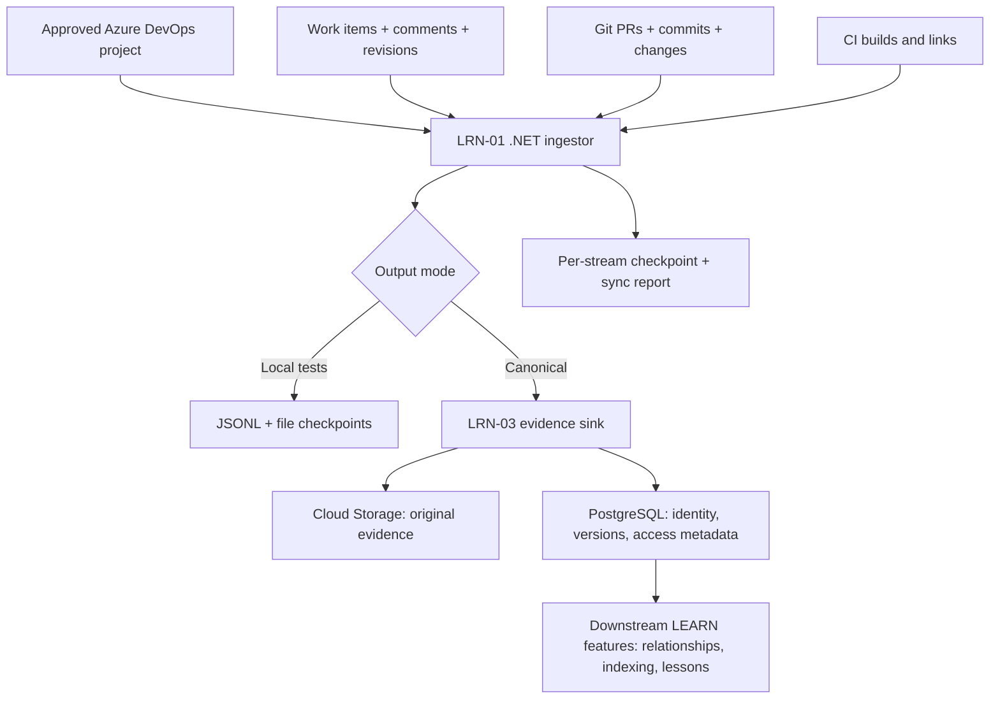

# LRN-01 — Connect to the history sources

> **In one sentence:** VisionIQ reads approved engineering history from Azure DevOps and makes that evidence available to downstream LEARN features.

**Story:** [LRN-01 on Trello](https://trello.com/c/Zg15086C/7-learn-lrn-01-connect-to-the-history-sources) · **Status:** Core tests pass; changed-file live verification and full current-branch regression are outstanding. **Do not merge PR #14 yet.**

## Why we need this

Suppose a ticket vending machine fails after a payment attempt. A similar bug may have been resolved months earlier, with an explanation in a work-item comment, a code change in a pull request and a build result. Unless VisionIQ reads those sources, it cannot reliably refer to that history.

**LRN-01 retrieves, rather than interprets, evidence.** It is not a model-training job or a search engine. Later features store, normalize, connect, index and qualify that history.

## What goes in and what comes out

- **Input:** approved ADO organization/projects, work items and their revisions/comments, repos, pull requests, commits, repository change metadata, builds, and relationships.
- **Output:** stream records and a per-stream sync report; in canonical mode evidence is archived via the LRN-03 PostgreSQL/GCS pipeline.
- **State:** per-project/repository checkpoints let later runs resume instead of starting over.
- **Failure behavior:** an unreachable or failing stream reports NOT SYNCED/partial; it must not be silently presented as empty.

## Big-picture diagram

*Arrows represent logical flow; deployment and scheduling are separate concerns.*

## How do we know it works?

Against the approved **WLMTS / Genoa Kiosk** scope: historical work items, comments, PRs, commits and now **86 CI builds with 149 links** were read. Canonical evidence was written to PostgreSQL/GCS, sampled GCS hashes matched, and test failures/retries were exercised in automated tests. The comments sample was **9/9, 2/2, 0/0**. These results demonstrate the tested connector pipeline, not complete downstream AI quality.

See [acceptance.md](acceptance.md) and the [detailed dated test report](../../LRN-01-Test-Report.md).

## Start here

1. [Architecture and diagrams](architecture.md) — understand what is connected.
2. [Implementation guide](implementation.md) — locate the code.
3. [Local testing](local-testing.md) — run safely and interpret output.
4. [Operations and demo preparation](operations.md) — backfill, incremental refresh and checkpoints.
5. [Cloud execution plan](cloud-deployment.md) — what runs in a container and what is not yet deployed.
6. [Acceptance checklist](acceptance.md) — proof, limitations and next actions.

**Security:** Never commit PATs, raw work-item content, customer data or unrestricted evidence exports. Restrict ingestion to explicitly approved projects, repositories, spaces and buckets.
