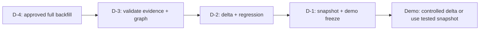

# LRN-01 — Operations, recovery and demo preparation

## Three sync types

| Type | When | Why |
|---|---|---|
| Historical backfill | Initial approved setup or controlled rebuild | Read older eligible records |
| Incremental sync | Repeatedly while operating | Refresh from persisted checkpoints |
| Reconciliation sweep | After missed events or suspected drift | Look back without replacing delta checkpoint semantics |

A completed job is normal: “always-on LEARN” describes continually updated knowledge, **not a process that spins forever**.

## Before-demo sequence

**D-4:** freeze the approved project/repository/pipeline list. Estimate volume first. In an isolated environment perform the backfill, capture run IDs, source counts, failures, timestamp bounds, and checkpoint snapshots. Check canonical immutability/reimport semantics; never blindly run `--full` on production/shared evidence.

**D-3:** compare representative ADO work items and historical revisions to source; verify comments, commit/PR relationships, CI runs, changed-file metadata, GCS hash samples and access boundaries. Confirm downstream graph, normalization and search results separately.

**D-2:** incremental run and replay; run current branch regression, investigate exceptions, protect against unexpected source count drops.

**D-1:** lock representative evidence-backed demo cases; take an authorized snapshot or reproducible export; note last successful ingestion and known gaps.

**Demo:** prefer validated evidence plus a controlled delta. Do not trigger broad full-history sync on stage.

## Failure diagnosis

| Symptom | Interpretation | Response |
|---|---|---|
| Exit 2 / NOT SYNCED | Inaccessible or failed source/stream | Inspect safe log and report; fix permissions/connectivity then retry |
| 0 new records | May be no changes since cursor | Check source update timestamps and saved cursor; don't assume ingestion failed |
| Comment gap/truncated flag | Source comments incomplete | Check permissions, pagination and source API status |
| PostgreSQL/GCS write fails | Evidence not durably committed | Verify checkpoint did not advance past unwritten records; restore destination and retry |
| Changed records don't appear | Cursor/lookback/scope issue | Check source-specific checkpoint, approved filters and reconciliation plan |

## What to keep in the evidence report

Source scope; executable commit SHA; sanitized run ID, command flags, stream counts, failures/quarantine, cursors, regression totals, and any authorized sampled source comparisons. Never log PATs or raw ticket text in public documentation.

**Do not alter Google Cloud IAM or wipe evidence to simulate failure.** Existing isolated automated tests exercise sink failure, checkpoint preservation and retry.
