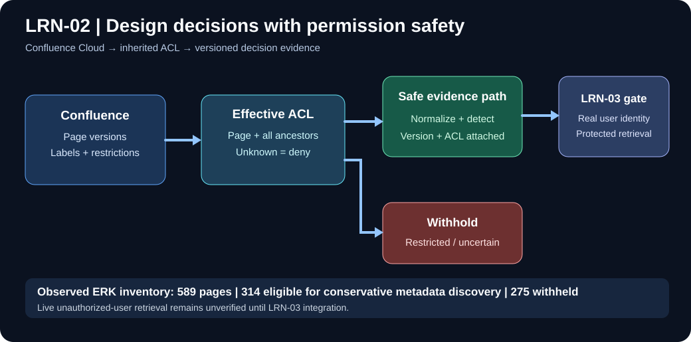
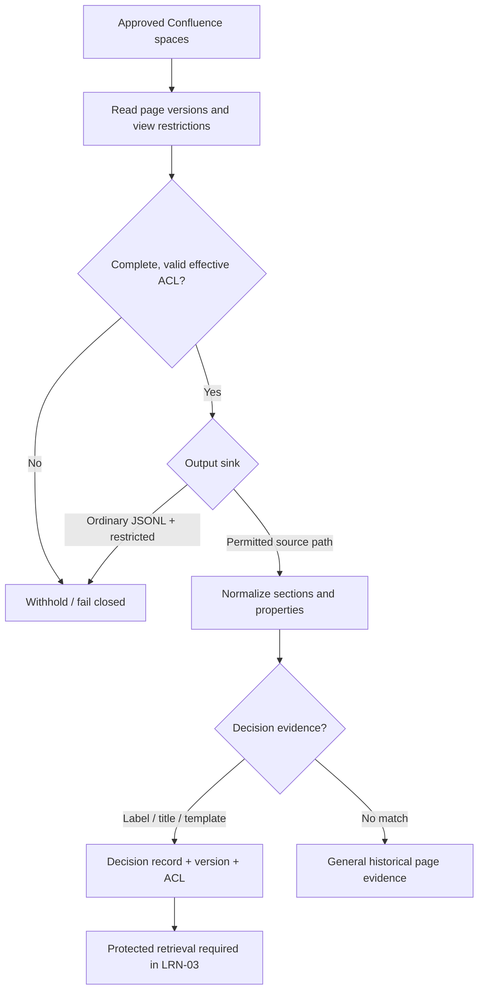
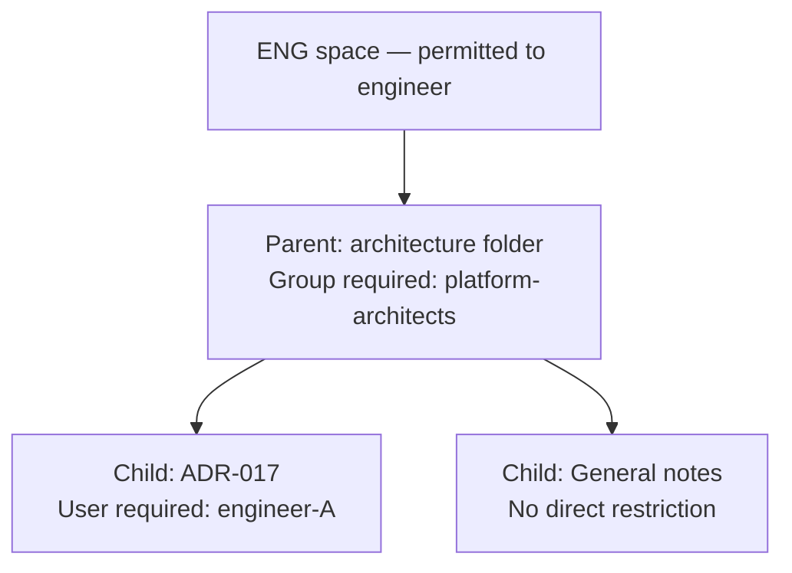
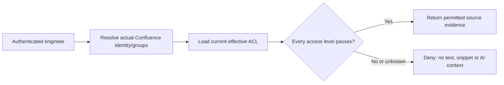

# LRN-02 — Illustrated walkthrough: design decisions and permissions

This companion explains *why* LRN-02 works this way, shows a fully synthetic permission example, and separates implemented safeguards from the retrieval integration not yet accepted.



## 1. Why engineering decisions matter

**Illustrative example (not a real Confluence page):** A team once selected a 3-attempt retry budget to prevent payment retry storms. A future engineer sees a similar defect and proposes unlimited retrying. Historic design decisions should let VisionIQ explain *why* a limit exists, with a versioned Confluence source reference—rather than guessing from code alone.

## 2. How a page becomes a decision record



The implemented `DesignDecisionDetector` recognizes decision-oriented **labels**, **titles**, or **template properties** (e.g. Status and Outcome). A metadata-only discovery run checks titles and labels; it does **not** inspect body templates, so zero candidates is inconclusive.

## 3. Inherited restrictions: why the parent matters

Suppose the fictional page tree is:



Even if an engineer is allowed into the space, the child ADR requires both the parent-level group membership **and** the child-level user match. “General notes” still inherits the parent's group restriction. If the parent cannot be read or ACL resolution is incomplete, **deny** rather than assuming public access.

| Synthetic requester | Correct ADR outcome | Explanation |
| --- | --- | --- |
| Engineer A, in platform-architects, approved space | Allow | Passes space, parent and child gates |
| Engineer A, not in platform-architects | Deny | Fails parent restriction |
| Engineer B, in platform-architects | Deny | Fails child restriction |
| No resolved identity | Deny | Restricted page needs a known matching principal |
| Engineer A with incomplete ACL | Deny | Unknown permission state fails closed |

These are explanatory fixtures and algorithm expectations, **not evidence of live account impersonation or end-to-end API tests**.

## 4. How discovery differs from secure retrieval

```mermaid
sequenceDiagram
    participant CLI as Discovery CLI
    participant C as Confluence Cloud
    participant A as ACL evaluator
    CLI->>C: Fetch approved-space page metadata
    C-->>CLI: IDs, titles, parent links, restrictions
    CLI->>A: Compute inherited ACLs
    A-->>CLI: Complete/unrestricted vs withheld
    loop Only complete and unrestricted metadata pages
        CLI->>C: Fetch labels (no body)
        C-->>CLI: Label names
    end
    CLI-->>CLI: Count title and label matches
    Note over CLI: Print counts only; no page titles or bodies
```

Discovery deliberately excludes **all restricted pages**, even those an authorized engineer might personally view. It is a privacy-preserving inventory, not a personal search service or a proof that every unrestricted page is readable by every engineer.

## 5. Understanding the actual ERK results

| Observed result | Count | Interpretation |
| --- | ---: | --- |
| Pages enumerated | 589 | Page metadata discovered in approved scope |
| Complete ACLs | 527 | ACL traversal completed |
| Complete + unrestricted | 314 | Eligible for conservative metadata discovery |
| Complete + restricted | 213 | Excluded from discovery |
| Incomplete ACLs | 62 | Excluded until resolved |
| Title candidates | 0 | No eligible title matches |
| Label candidates | 0 | No eligible label matches |
| Label fetch failures | 0 | All eligible label queries completed |
| Locally exported page samples | 2 | Versioned samples from date-filtered sync |
| Confluence-focused automated tests | 37/37 | Simulated authorization, normalization and source logic |

The 275 excluded pages are 213 restricted + 62 incomplete ACLs. The local sync was **Partial (exit 2)** because some fresh pages were withheld; this is expected safety behavior, not a full historical import.

## 6. The test still needed to close LRN-02



**LRN-03 must implement and validate this protected read path.** A positive and negative test must demonstrate that an authorized engineer receives permitted evidence while another authenticated engineer cannot retrieve its text, search snippet or AI context, including after permission revocation.

## 7. Related resources

[Architecture](01-Architecture-and-Implementation.md) · [Operations](02-Setup-and-Operations.md) · [Recorded tests](03-Test-Report-and-Evidence.md) · [Acceptance and LRN-03 handoff](04-Acceptance-and-LRN03-Handoff.md).
