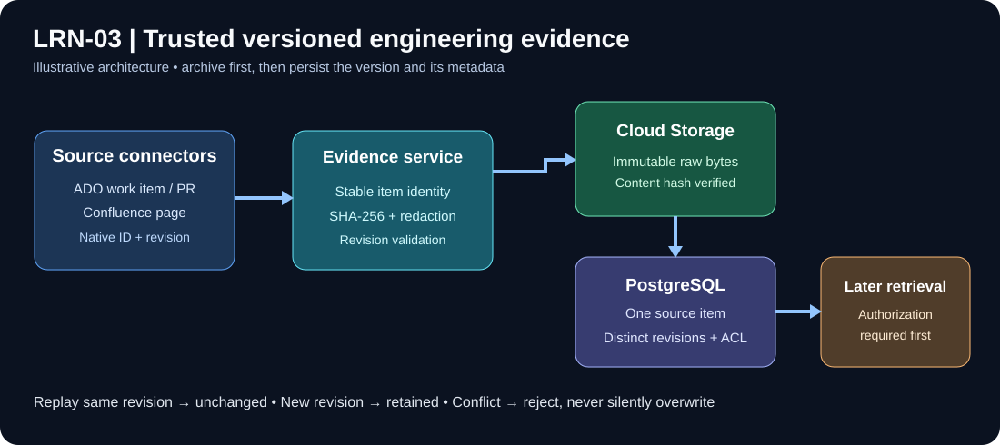
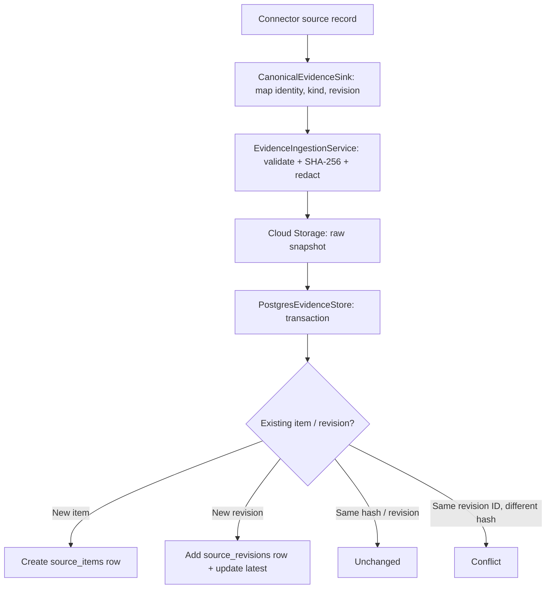

# LRN-03 — Architecture and implementation explained

**Scope:** Existing implementation review against [LRN-03 Trello](https://trello.com/c/aqRFYZ9G/9-learn-lrn-03-store-history-as-versioned-evidence). This is a storage feature, **not** a claim that authorized retrieval is complete.



## Mental model: one item, multiple source revisions

Imagine one fictional ticket ID 42. Revision 1 says Open; revision 2 says Resolved. VisionIQ must store **one item identity** and **two revisions**, with timestamps, source URLs, access metadata and raw archive references. Reimporting the same revision must not add a third row. If revision 2 comes back with a different payload but the same revision ID, it is a **conflict**, not a silent update.



## Code map and design decisions

| Component | File | Behavior seen in code |
| --- | --- | --- |
| Stable identity | `src/VisionIQ.Api/Features/Evidence/EvidenceModels.cs` | Length-delimited hash across provider, source instance, project, optional repository, kind, native external ID |
| Envelope/access | Same file | Native revision, source/observation timestamps, HTTPS source URL, source principal, raw bytes and access metadata |
| Metadata redaction | Same file | Allowlist of short structured scalar fields; unknown kinds return only kind |
| Service | `src/VisionIQ.Api/Features/Evidence/EvidenceIngestionService.cs` | Validates fields and JSON size, UTC timestamps, computes SHA-256, archives raw bytes before DB write |
| Persistence | `src/VisionIQ.Api/Features/Evidence/PostgresEvidenceStore.cs` | Transactional item upsert, existing-revision hash check, new revision insert, latest pointer logic |
| Source mapping | `src/VisionIQ.Ingestor.Cli/CanonicalEvidenceSink.cs` | ADO/Confluence stream normalization into canonical envelopes |
| Schema migration | `db/migrations/versions/20261030_0002_versioned_evidence.py` | Item PK, composite revision PK, foreign keys, JSONB shape constraints, indexes |
| Local database roles | `db/manage.py` | `migrate`, `roles`, `verify`, `all`; internally, `roles` invokes `bootstrap(settings)` |

## Identity versus revision

The stable item key identifies the *logical source item*. Its source revision ID identifies a *particular state of that item*. The same item can have multiple native revisions without duplicating its identity. A null repository is an intentional part of identity and is distinct from a repository ID.

The schema's `source_items` row has `latest_revision_id`, `latest_source_updated_at`, first and last observation timestamps. `source_revisions` stores the source revision, SHA-256, URL, GCS URI, source/observation timestamps, ACL flags/list, and redacted JSON. A deferred composite foreign key protects the latest pointer from referencing another source item's revision.

## Security boundaries

- Raw archive contents must stay in authorized Cloud Storage, not public documentation or logs.
- A `gs://` URI means the archive abstraction returned a location; it does not by itself prove object immutability or IAM.
- `EvidenceNormalizer` is metadata **allowlisting**, not unrestricted text extraction or general-purpose PII removal.
- Confluence space-level metadata does **not** establish inherited page-level read authorization for a requesting engineer. See [LRN-02 acceptance handoff](../LRN-02-confluence/04-Acceptance-and-LRN03-Handoff.md).

## Current review findings

Existing mappings include ADO work-item current/revisions, PR, commit, CI builds, links, and Confluence page/decision/ACL data. The reviewed sink switch did not show standalone review, deployment or incident cases; these remain a **coverage audit question**, not an automatic claim of noncompliance. See [live audit](01-Code-Audit.md) for tasks and status.

## Downstream indexing redaction review — 2 November 2026

**Code-level finding:** `EvidenceNormalizer.SafeFields` previously copied `commentTruncated` for commits and `environmentRaw` / `environmentReason` / `environment` for work item current records, even though these source-derived strings could contain free text or sensitive values. These have been removed from the normalized indexable metadata allowlist. The safe work-item-current fields now include `state`, `workItemType`, `environmentStatus`, `environmentSource`; commit records include only `kind`. The raw original still belongs in authorized GCS archive, not a search projection.

**Regression coverage added:** `Lrn03EvidenceBoundaryTests.Indexable_metadata_never_contains_synthetic_sensitive_source_text` has four synthetic examples covering commit commentary, work-item environment raw/reason, work-item description and Confluence page text. **Local execution pending**, not yet a pass.

```powershell
git switch feature/learn
git pull
dotnet test .\\tests\\VisionIQ.Ingestor.Tests\\VisionIQ.Ingestor.Tests.csproj --configuration Release --filter "FullyQualifiedName~Lrn03EvidenceBoundaryTests" --verbosity minimal
Write-Host "LRN-03 redaction tests exit code: $LASTEXITCODE"
```

**Important distinction:** tests prove the normalization/ingestion **boundary** excludes specified text and PostgreSQL stores its `redacted_payload`. They do **not** prove there is an actual deployed downstream vector/full-text index consuming only this JSON. A deployment-specific index writer or retrieval path must be located and tested independently before full indexing signoff. Existing stored rows may need a controlled backfill/reindex to pick up normalization changes; there is no automatic retroactive rewrite in this patch.
