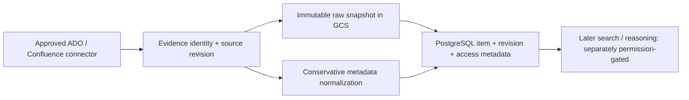

# LRN-03 — Store history as versioned evidence

> **Story:** [LRN-03 on Trello](https://trello.com/c/aqRFYZ9G/9-learn-lrn-03-store-history-as-versioned-evidence)  
> **Status:** EXISTING IMPLEMENTATION UNDER ACCEPTANCE REVIEW — not a new build. Original LRN-03 functionality was implemented earlier alongside LRN-01–07; this phase audits it against the original Trello card and verifies real persistence. Documentation is maintained **alongside each review, fix and test**, not after story completion.  
> **Scope:** S05-01 through S05-06, S05-11; approved PostgreSQL / GCS evidence persistence and conservative normalization.


**Review progress:** [Detailed code audit and Trello task matrix](01-Code-Audit.md). This audit identifies existing implementation, specific unverified areas and executable tests; it is updated as the review proceeds.

## Complete LRN-03 documentation index

1. [Existing code audit and Trello task mapping](01-Code-Audit.md) — factual review findings and gaps.
2. [Architecture and implementation explained](02-Architecture-and-Implementation.md) — visual design, code responsibility, identity, revisions, access and redaction.
3. [Setup, executable commands and troubleshooting](03-Setup-Commands-and-Troubleshooting.md) — Windows PowerShell runbook, isolated PostgreSQL, CLI commands, failure resolutions.
4. [Actual test evidence and acceptance](04-Test-Evidence-and-Acceptance.md) — every observed result, outstanding gates and original user-story acceptance.
5. [GCS archive verification and live runbook](05-GCS-Archive-Verification.md) — existing GCS implementation, conditional writes, exact SHA-256 check and isolated live test.\n6. [Deployed index/retrieval audit](06-Index-Retrieval-Deployment-Audit.md) — read-only infrastructure inventory, search-index contract and authorization acceptance.\n7. [Visual architecture image](images/lrn03-evidence-flow.svg) — end-to-end source → archive → versioned database.

**Current correction:** The local CLI command is `python -m db.manage roles`, **not** `bootstrap`. The latter was a wrong recommendation and resulted in argument-parser exit 2. This is documented in the operations guide and test evidence.

## The problem, explained

An Azure DevOps ticket can be revised many times. An engineer might change a description, attach a PR, and resolve the ticket. If VisionIQ saves only the latest text, it loses **what was known when**. If every sync inserts a new item, searches become full of duplicates. If it stores private text directly in an index, it can leak secrets.

**Illustrative example (fictional, not company data):** A ticket is first imported at revision 3. Reimporting revision 3 again should leave that revision unchanged; importing revision 4 should preserve the earlier revision and update the latest reference. Both raw revisions must remain traceable to their source, without adding private free text to indexed metadata.

## What LRN-03 actually includes

| Acceptance criterion | Implementation already present | Validation status |
| --- | --- | --- |
| Source identity, revision, timestamps, access metadata | `EvidenceIdentity`, `EvidenceEnvelope`, `PostgresEvidenceStore` | Code found; fresh test execution pending |
| Immutable GCS raw record; redaction before indexing | `EvidenceIngestionService`, `EvidenceNormalizer`, archive service | Code found; fresh archive/hash and secret-exclusion checks pending |
| Idempotent import; two revisions of one source item | PostgreSQL upsert/revision handling | Code found; fresh real DB integration verification pending |

**Official completion evidence:** the same item imported twice leaves **one logical item and two distinct source revisions** (where the two imports include two native revision IDs and a replay).

## Architecture, step by step



1. **Identity:** provider, source instance, project, optional repository, item kind and external ID are combined into a stable item key. Different sources must not accidentally collide.
2. **Version:** the source-native revision and source update timestamp describe the source change. Observation timestamp describes when the connector saw it. Keep both.
3. **Redaction:** `EvidenceNormalizer` uses a restrictive allowlist of short structured metadata. Raw descriptions and source text must not be copied into unreviewed search metadata.
4. **Archive first:** raw bytes are content-hashed and saved in GCS before the PostgreSQL revision is persisted. Failures must not silently advance the evidence state.
5. **Upsert:** a replay of an identical item+revision should be unchanged, while a new revision gets a separate row. Same revision ID with different content must be treated as a conflict, not silently overwritten.
6. **Security:** storing an ACL or space principal does not prove a particular requesting engineer can read the page. LRN-02 retrieval authorization remains open until an actual protected read path is tested.

## Code map

| Source location | Responsibility |
| --- | --- |
| `src/VisionIQ.Api/Features/Evidence/EvidenceModels.cs` | Stable identity, access metadata, version envelope, conservative normalizer |
| `src/VisionIQ.Api/Features/Evidence/EvidenceIngestionService.cs` | Validation, SHA-256, redaction, archive-before-database sequence |
| `src/VisionIQ.Api/Features/Evidence/PostgresEvidenceStore.cs` | Item/revision persistence and idempotent upsert |
| `src/VisionIQ.Ingestor.Cli/CanonicalEvidenceSink.cs` | Maps connector source records to canonical envelopes |
| `src/VisionIQ.Api/Features/Evidence/` | Archive and evidence storage interfaces/implementations |
| `tests/VisionIQ.Ingestor.Tests/` | Relevant ingestion/normalization and integration test code |

## Additional review regression tests (not evidence of new feature implementation)

Additional synthetic regression tests were added during the review in `tests/VisionIQ.Ingestor.Tests/Lrn03EvidenceBoundaryTests.cs`:

- Raw evidence is archived before a database store call.
- An archive failure prevents a database write.
- Stable item identities differ across provider/repository boundaries.
- Unknown record kinds do not leak unreviewed values into redacted metadata.

Run from the repo root:

```powershell
dotnet test .\tests\VisionIQ.Ingestor.Tests\VisionIQ.Ingestor.Tests.csproj `
  --configuration Release `
  --filter "FullyQualifiedName~Lrn03EvidenceBoundaryTests" `
  --verbosity normal
if ($LASTEXITCODE -ne 0) { throw "LRN-03 focused tests failed" }
```

**Status:** additional test source committed; local execution and results **not yet observed**. Existing tests and existing previously recorded LRN-01 canonical archive evidence must also be reviewed; do not infer LRN-03 was unimplemented from this addition. This synthetic suite does not validate real PostgreSQL row constraints, GCS object contents, or GCP IAM. Those need separate integration testing.

## Trello implementation task audit (review, not new implementation)

| Task | Review target | Status |
| --- | --- | --- |
| S05-01 Canonical evidence schema | PostgreSQL migrations, evidence tables and constraints | Awaiting full migration review |
| S05-02 Source identity strategy | `EvidenceIdentity.ItemKey`, source collisions and keys | Existing code located; tests pending |
| S05-03 Raw immutable snapshot archive | GCS object implementation, hash/object existence and failure behavior | Existing code path located; live validation pending |
| S05-04 Work-item revision normalization | Canonical mappings for work-item revisions | Existing sink located; audit pending |
| S05-05 PR, commit, review normalization | Canonical mappings and field fidelity | Existing sink located; audit pending |
| S05-06 CI, deployment, incident normalization | Accepted record types and safe normalizer output | Existing normalizer located; audit pending |
| S05-11 Deduplication/upsert | PostgreSQL same-item replay, new revision and conflict | Existing store located; actual DB test pending |

Existing LRN-01 test evidence included canonical PostgreSQL/GCS writes, 5/5 sampled GCS hash checks and duplicate-key checks in a sample. These are **supporting evidence**, not a completed LRN-03 two-revision acceptance run.

## Source-of-truth acceptance checklist

- [x] Original Trello acceptance criteria retrieved and documented.
- [x] Existing implementation locations identified.
- [ ] Review schema and identity constraints against every accepted source kind.
- [ ] Validate raw object integrity and archive-before-database failure behavior.
- [ ] Validate that normalized/indexable metadata excludes secrets and unrestricted text.
- [ ] Run PostgreSQL integration: same item replayed, then second revision, verify one logical item and two revisions.
- [ ] Record command output, test counts, sanitized evidence, and any defects addressed.
- [ ] Only then mark LRN-03 accepted.

## Documentation workflow

After each meaningful change, update this folder with: (1) implementation explanation, (2) architecture diagram if flow changed, (3) actual PowerShell commands run, (4) sanitized expected/observed outputs, and (5) acceptance status. Never record corporate ticket content, tokens or unapproved access lists. Don't merge the draft LEARN PR until agreed story validation is complete.

**Related:** [LRN-01 visual guide](../LRN-01-history-connectors/visual-guide.md), [LRN-02 acceptance handoff](../LRN-02-confluence/04-Acceptance-and-LRN03-Handoff.md).
