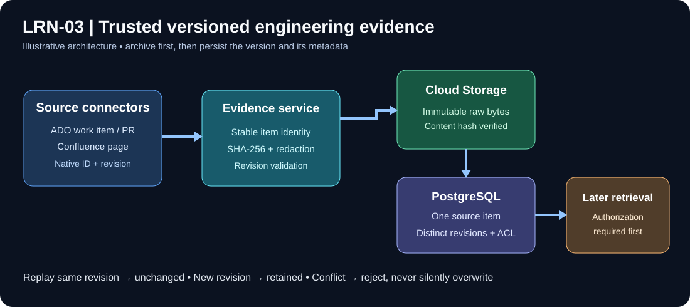
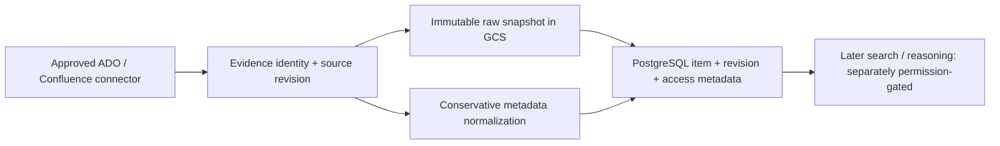

# LRN-03 — Store history as versioned evidence

> **Story:** [LRN-03 on Trello](https://trello.com/c/aqRFYZ9G/9-learn-lrn-03-store-history-as-versioned-evidence)  
> **Status:** IN PROGRESS — existing implementation under review. Documentation is maintained **alongside each code/test change**, not after story completion.  
> **Scope:** S05-01 through S05-06, S05-11; approved PostgreSQL / GCS evidence persistence and conservative normalization.

## The problem, explained

An Azure DevOps ticket can be revised many times. An engineer might change a description, attach a PR, and resolve the ticket. If VisionIQ saves only the latest text, it loses **what was known when**. If every sync inserts a new item, searches become full of duplicates. If it stores private text directly in an index, it can leak secrets.

**Illustrative example (fictional, not company data):** A ticket is first imported at revision 3. Reimporting revision 3 again should leave that revision unchanged; importing revision 4 should preserve the earlier revision and update the latest reference. Both raw revisions must remain traceable to their source, without adding private free text to indexed metadata.

## What LRN-03 actually includes

| Acceptance criterion | Implementation already present | Validation status |
| --- | --- | --- |
| Source identity, revision, timestamps, access metadata | `EvidenceIdentity`, `EvidenceEnvelope`, `PostgresEvidenceStore` | Code found; fresh test execution pending |
| Immutable GCS raw record; redaction before indexing | `EvidenceIngestionService`, `EvidenceNormalizer`, archive service | Code found; fresh archive/hash and secret-exclusion checks pending |
| Idempotent import; two revisions of one source item | PostgreSQL upsert/revision handling | Code found; fresh real DB integration verification pending |

**Official completion evidence:** the same item imported twice leaves **one logical item and two distinct source revisions** (where the two imports include two native revision IDs and a replay).

## Architecture, step by step

1. **Identity:** provider, source instance, project, optional repository, item kind and external ID are combined into a stable item key. Different sources must not accidentally collide.
2. **Version:** the source-native revision and source update timestamp describe the source change. Observation timestamp describes when the connector saw it. Keep both.
3. **Redaction:** `EvidenceNormalizer` uses a restrictive allowlist of short structured metadata. Raw descriptions and source text must not be copied into unreviewed search metadata.
4. **Archive first:** raw bytes are content-hashed and saved in GCS before the PostgreSQL revision is persisted. Failures must not silently advance the evidence state.
5. **Upsert:** a replay of an identical item+revision should be unchanged, while a new revision gets a separate row. Same revision ID with different content must be treated as a conflict, not silently overwritten.
6. **Security:** storing an ACL or space principal does not prove a particular requesting engineer can read the page. LRN-02 retrieval authorization remains open until an actual protected read path is tested.

## Code map

| Source location | Responsibility |
| --- | --- |
| `src/VisionIQ.Api/Features/Evidence/EvidenceModels.cs` | Stable identity, access metadata, version envelope, conservative normalizer |
| `src/VisionIQ.Api/Features/Evidence/EvidenceIngestionService.cs` | Validation, SHA-256, redaction, archive-before-database sequence |
| `src/VisionIQ.Api/Features/Evidence/PostgresEvidenceStore.cs` | Item/revision persistence and idempotent upsert |
| `src/VisionIQ.Ingestor.Cli/CanonicalEvidenceSink.cs` | Maps connector source records to canonical envelopes |
| `src/VisionIQ.Api/Features/Evidence/` | Archive and evidence storage interfaces/implementations |
| `tests/VisionIQ.Ingestor.Tests/` | Relevant ingestion/normalization and integration test code |

## Source-of-truth acceptance checklist

- [x] Original Trello acceptance criteria retrieved and documented.
- [x] Existing implementation locations identified.
- [ ] Review schema and identity constraints against every accepted source kind.
- [ ] Validate raw object integrity and archive-before-database failure behavior.
- [ ] Validate that normalized/indexable metadata excludes secrets and unrestricted text.
- [ ] Run PostgreSQL integration: same item replayed, then second revision, verify one logical item and two revisions.
- [ ] Record command output, test counts, sanitized evidence, and any defects addressed.
- [ ] Only then mark LRN-03 accepted.

## Documentation workflow

After each meaningful change, update this folder with: (1) implementation explanation, (2) architecture diagram if flow changed, (3) actual PowerShell commands run, (4) sanitized expected/observed outputs, and (5) acceptance status. Never record corporate ticket content, tokens or unapproved access lists. Don't merge the draft LEARN PR until agreed story validation is complete.

**Related:** [LRN-01 visual guide](../LRN-01-history-connectors/visual-guide.md), [LRN-02 acceptance handoff](../LRN-02-confluence/04-Acceptance-and-LRN03-Handoff.md).
